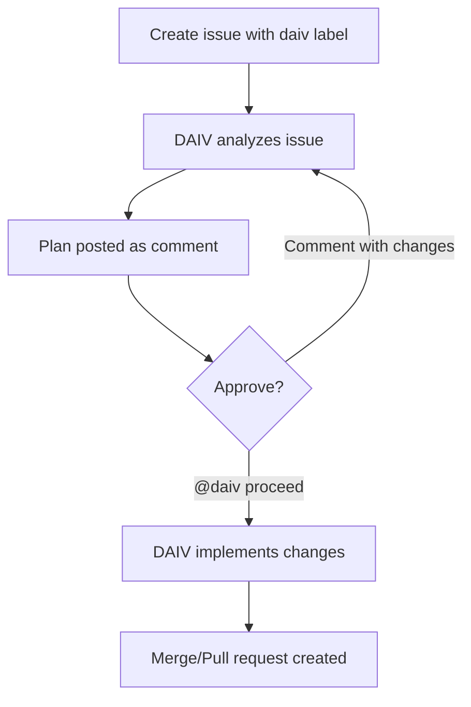

# Issue addressing

Issue addressing turns an issue into code. DAIV reads a labelled issue, posts an implementation plan, waits for your approval, and opens a merge request (GitLab) or pull request (GitHub) with the changes.

## How it works

1. You create or update an issue and add a bot label.
2. DAIV reads the issue title, description, and any attached images.
3. DAIV posts a plan as a comment on the issue.
4. You review the plan and approve it, or comment with the changes you want, and DAIV revises the plan.
5. DAIV implements the plan and opens a merge or pull request.



## Issue labels

Add one of these bot labels to an issue to hand it to DAIV:

| Label | Behavior |
|-------|----------|
| `daiv` | Generates a plan and waits for approval before implementing |
| `daiv-auto` | Generates a plan and executes it immediately without waiting for approval |
| `daiv-max` | Uses a more capable model with deeper reasoning; see [Max mode](#max-mode) |

Labels are case-insensitive (`DAIV`, `Daiv`, and `daiv` all work). You can combine labels: `daiv-auto` with `daiv-max` runs the plan at once, on the more capable model.

When the merge request DAIV opened for an issue merges, DAIV [archives the issue's session](sessions.md#archived-sessions). A label or mention on the issue then starts nothing until someone unarchives the session, and DAIV replies with a link to it.

## Approve a plan

With the `daiv` label, DAIV waits for your approval after it posts a plan and makes no code changes before it. To approve the plan:

1. Open the issue and read the plan DAIV posted.
2. Add a comment that mentions DAIV, for example:

    ```text
    @daiv proceed
    ```

The exact wording is not a keyword. DAIV reacts to any comment that mentions it (`@daiv`); it reads your comment together with the plan it posted and acts on your intent. A comment like `@daiv looks good, go ahead` works the same as `@daiv proceed`.

Your comment can also carry feedback or extra instructions. DAIV either applies them while it implements the plan or revises the plan from them. If you disagree with the plan, comment with the changes you want and DAIV updates the plan.

## Answer a question from DAIV

When the issue or your feedback is ambiguous in a way that changes the work, or the choice is yours to make, DAIV can post a question instead of guessing. The question mentions you and ends with "reply mentioning `@daiv` with your answer." To answer, leave a new comment that mentions DAIV. On GitLab, DAIV posts its question inside the discussion thread of the comment that triggered it, so replying in that same thread keeps the conversation together; on GitHub the question is always a top-level comment.

## Max mode

The `daiv-max` label switches DAIV to the site's max model with its max thinking level, which suits complex issues that need deeper analysis. An administrator sets both, with the `DAIV_AGENT_MAX_MODEL_NAME` and `DAIV_AGENT_MAX_THINKING_LEVEL` variables or in [Site configuration](../reference/site-configuration.md); the [environment variables reference](../reference/env-variables.md) lists their defaults.

## Run DAIV again

To run a second plan on an issue DAIV already addressed, add a new comment that mentions `@daiv` and says what you want. DAIV updates the existing merge or pull request instead of creating a new one. Adding the label again does not start a run: DAIV ignores a label on an issue it already reacted to.

## When a run fails

If an unexpected error stops DAIV while it implements a plan, DAIV opens a **draft** merge or pull request to keep the changes it already made.

## AGENTS.md suggestion

When DAIV creates a merge request for a repository that doesn't have an [`AGENTS.md`](https://agents.md/) file (or whatever `context_file_name` is configured to), DAIV adds a comment suggesting you create one. The comment includes a one-click link that opens an issue with the `daiv-auto` label already set. When you submit that issue, DAIV runs the [`/init` skill](slash-commands.md#init) at once, with no approval step, and opens a merge or pull request with the generated `AGENTS.md`.

To stop the suggestion on one repository, set `suggest_context_file: false` in its `.daiv.yml`. To stop it on every repository, set `DAIV_SUGGEST_CONTEXT_FILE_ENABLED` to `false`. [Repository configuration](../customization/repository-config.md) and the [environment variables reference](../reference/env-variables.md) describe both.

## Turn off issue addressing

Issue addressing is on by default. To turn it off for a repository, add this to its `.daiv.yml`:

```yaml
issue_addressing:
  enabled: false
```

[Repository configuration](../customization/repository-config.md) lists every feature toggle and who can trigger DAIV.

## Related pages

- [Repository configuration](../customization/repository-config.md) — restrict who can trigger DAIV and turn features on or off
- [Slash commands and skills](slash-commands.md) — steer an issue with `/plan` and custom skills
- [Pull request assistant](pull-request-assistant.md) — what happens once the merge request is open
- [Sandbox](sandbox.md) — where the implementation is built and tested
