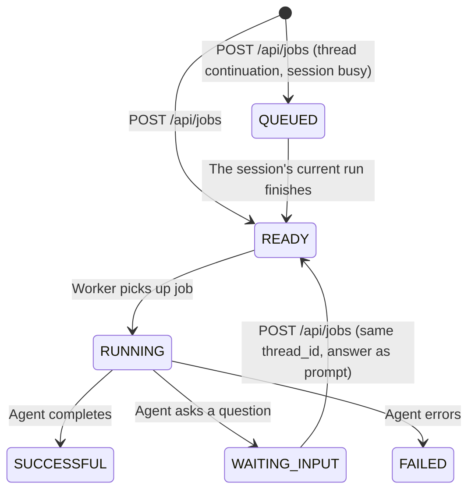

# Jobs API

The Jobs API lets you trigger DAIV agents programmatically — outside of the usual git webhook flow. Submit a prompt, get a job ID, and poll for the result.

This is useful when you want to:

- **Run agents on a schedule** — e.g., a GitLab CI pipeline that runs nightly
- **Chain agent tasks** — e.g., triage tickets, then create issues from the report
- **Trigger from external tools** — Slack bots, scripts, or custom integrations
- **Run ad-hoc tasks** — quick one-off agent executions via curl

## Authentication

The Jobs API uses **API key authentication** via Bearer tokens — the same mechanism used by the chat completions API.

### Creating an API key

```bash
django-admin create_api_key <username> --name "my-key"
```

This outputs a key in the format `prefix.secret`. Store it securely — it cannot be retrieved later.

### Managing API keys

You can also self-service your API keys from the dashboard at `/accounts/api-keys/`. There you can:

- **Create** a key by giving it a name — the full secret is shown **only once**, right after creation, so copy it immediately.
- **List** your keys (admins see every user's keys).
- **Revoke** a key you no longer need; revoked keys stop authenticating immediately.

The `create_api_key` management command remains available for headless/automated provisioning.

### Using the key

Pass the key in the `Authorization` header:

```bash
curl -X POST https://daiv.example.com/api/jobs \
  -H "Authorization: Bearer <your-api-key>" \
  -H "Content-Type: application/json" \
  -d '...'
```

## Rate limiting

Job submissions are rate-limited per authenticated user. The default limit is **20 requests per hour**. When exceeded, the API returns `429 Too Many Requests`.

The rate is configured via the `jobs_throttle_rate` field in Site Configuration (default `20/hour`). Set it to a value like:

```
50/hour
```

Valid formats: `N/sec`, `N/min`, `N/hour`, `N/day` (or single-letter short forms: `N/s`, `N/m`, `N/h`, `N/d`).

!!! note
    The same rate can also be set with the `DAIV_JOBS_THROTTLE_RATE` environment variable (or Docker secret). When set, it is a hard override that wins over the database value and **locks** the field in the Site Configuration UI.

## Endpoints

### Submit a job

```
POST /api/jobs
```

**Request body:**

| Field                  | Type             | Required | Description |
|------------------------|------------------|----------|-------------|
| `repos`                | array of objects | yes      | 1–20 repositories to run against. Each item: `{ "repo_id": "group/project", "ref": "branch", "prompt": "..." }` — `ref` is optional, must be a branch that exists on the remote, and defaults to the repository's default branch; `prompt` is optional, must not be blank, and replaces the batch `prompt` for that repository only. A new MR/PR targets it, and is assigned to the API key's owner when their DAIV account is OAuth-linked to the git platform. |
| `prompt`               | string           | yes      | The prompt to send to the agent. It runs as an independent job against each repository in `repos`, except one that gives its own `prompt`, and it titles the batch. |
| `agent_model`          | string           | no       | Override the model used for this batch. Invalid model / thinking-level combinations are rejected with `400`. |
| `agent_thinking_level` | string           | no       | Override the agent's reasoning effort. One of `minimal`, `low`, `medium`, `high`, `xhigh`. Invalid combinations are rejected with `400`. |
| `muted`                | boolean          | no       | Mute notifications for every job in this batch. Default false. |
| `environment`          | string           | no       | Select a sandbox environment (by name or id) applied to every job in the batch. An unresolvable environment is rejected with `400`. |
| `shared_session`       | boolean          | no       | Run all repositories in `repos` in **one** session instead of one job each. See [Multi-repository sessions](#multi-repository-sessions). |
| `thread_id`            | string (UUID)    | no       | Continue an existing thread. Requires exactly one repo in `repos` (a [multi-repository session](#continuing-a-multi-repository-session) also accepts its full list), and the most recent run on that thread must belong to you, and you must not have archived the session (otherwise `400`). If the session is busy, the job joins the session's next run for its branch, in `QUEUED` state, which starts once the current run ends; see [Job lifecycle](#job-lifecycle). |
| `references`           | array of objects | no       | Up to 20 external work-item references (Jira/Sentry/RT tickets, git-platform issues, …) that DAIV links into the MR/PR it creates. Each item: `{ "key": "PROJ-123", "url": "https://…", "provider": "jira", "relation": "relates" }` — only `key` is required. |
| `mcp_overrides`        | object           | no       | MCP servers to switch on or off for every job in the batch, relative to the default set: `{"grafana": true}` adds an on-demand server, `{"sentry": false}` drops an active one. Names are those of the global servers and your own personal ones; an unknown name is rejected with `400`, and a value other than `true`/`false` with `422`. On a continued thread (`thread_id`) they apply on top of the thread's own, so a server you don't name keeps its setting. A continuation that would change them while another run on the thread is unfinished is returned in `failed`, since that run would pick them up too. |

`references` is the same schema the MCP `submit_job` tool takes, validated by the same code; see [`references` on the MCP endpoint](mcp-endpoint.md#available-tools) for the per-field rules, the provider list, the `closes` auto-close semantics, the continuation merge, and the v1 limitation on existing MRs. An invalid reference (bad key charset, non-`http(s)` URL, more than 20 entries) is rejected with `422` and nothing is stored.

!!! note
    The request body is validated strictly: unknown fields (including the removed `use_max` toggle and the removed `notify_on` field) are rejected with `422`. Use `muted` to silence notifications; use `agent_model` and `agent_thinking_level` to control the model.

**Example:**

```bash
curl -s -X POST https://daiv.example.com/api/jobs \
  -H "Authorization: Bearer $DAIV_API_KEY" \
  -H "Content-Type: application/json" \
  -d '{
    "repos": [{"repo_id": "mygroup/myproject"}],
    "prompt": "List all Python files and summarize the project structure"
  }'
```

**Response (202 Accepted):**

```json
{
  "batch_id": "5b9e8a3c-9b7e-4c0d-a1f5-7e2c8d4b1a90",
  "jobs": [
    {
      "job_id": "1adfbf7a-917e-4f2e-8f54-17a27c006ec5",
      "repo_id": "mygroup/myproject",
      "ref": null,
      "thread_id": "9c1e8a3c-9b7e-4c0d-a1f5-7e2c8d4b1a90",
      "status": "READY"
    }
  ],
  "failed": []
}
```

Each entry in `jobs` is an independent run — poll each `job_id` separately. The `status` is `READY` for an immediately-runnable job, or `QUEUED` if the session named by `thread_id` is busy (see [Job lifecycle](#job-lifecycle)). Pre-enqueue rejections (e.g. unknown `repo_id`) are reported in `failed` as `{repo_id, ref, error}`; the rest of the batch still runs.

### Poll job status

```
GET /api/jobs/{job_id}
```

**Response (200 OK):**

```json
{
  "job_id": "1adfbf7a-917e-4f2e-8f54-17a27c006ec5",
  "status": "SUCCESSFUL",
  "thread_id": "9c1e8a3c-9b7e-4c0d-a1f5-7e2c8d4b1a90",
  "result": "Here are the Python files...",
  "merge_request_url": null,
  "artifacts": [
    {
      "id": "3f1c2b6e-0d7a-4f0e-9c4b-2a8d6e1f5b70",
      "title": "Dependency audit",
      "filename": "dependency-audit.html",
      "content_type": "text/html",
      "kind": "html",
      "size": 48213,
      "url": "https://daiv.example.com/dashboard/sessions/9c1e8a3c-9b7e-4c0d-a1f5-7e2c8d4b1a90/artifacts/3f1c2b6e-0d7a-4f0e-9c4b-2a8d6e1f5b70/",
      "download_url": "https://daiv.example.com/dashboard/sessions/9c1e8a3c-9b7e-4c0d-a1f5-7e2c8d4b1a90/artifacts/3f1c2b6e-0d7a-4f0e-9c4b-2a8d6e1f5b70/raw/?download=1"
    }
  ],
  "error": null,
  "created_at": "2026-03-27T18:22:39.012Z",
  "started_at": "2026-03-27T18:22:39.401Z",
  "finished_at": "2026-03-27T18:22:52.402Z"
}
```

`merge_request_url` is populated when the agent produced code changes that were committed and pushed; `null` otherwise (e.g. read-only triage runs). In a [multi-repository session](#multi-repository-sessions) it is the main repository's merge request, else the first one opened. `thread_id` identifies the thread this job ran on — pass it back as the `thread_id` field on a new submission to continue the conversation.

`artifacts` lists the files the agent published with its `publish_artifact` tool (reports, datasets, charts) — see [Artifacts](sessions.md#artifacts). Each entry carries the viewer page (`url`), a direct download (`download_url`), and a `kind` (`markdown`, `html`, `image`, `text`, or `other`) describing how the viewer renders it. Both `url` and `download_url` require a signed-in DAIV user who can see the run. An artifact that a later job on the same thread revises keeps its id and URLs, and is listed under both the job that first published it and every job that revised it, with its current file ([Revising an artifact](sessions.md#revising-an-artifact)). The list is empty for runs that published nothing, and it is populated as the run progresses, so it can be read while the job is still `RUNNING`. If DAIV cannot list the artifacts, `artifacts` is empty and `artifacts_error` explains why; the rest of the status is unaffected.

**Status values:**

| Status | Meaning |
|--------|---------|
| `QUEUED` | Job is the session's next run, waiting for its current run to finish. Only occurs for thread continuations (`thread_id` supplied). |
| `READY` | Job is queued, waiting for a worker |
| `RUNNING` | Agent is executing |
| `SUCCESSFUL` | Completed — `result` contains the agent's last response |
| `WAITING_INPUT` | The agent stopped to ask you a question instead of guessing — a terminal state, not a step towards `SUCCESSFUL`. `question` holds the questions asked, and `result` their rendered text |
| `FAILED` | Agent encountered an error — `error` contains a message |

### Answering a question

When a job comes back `WAITING_INPUT`, submit a new job with the same `thread_id` and your answer as `prompt`:

```bash
curl -s -X POST https://daiv.example.com/api/jobs \
  -H "Authorization: Bearer $DAIV_API_KEY" \
  -H "Content-Type: application/json" \
  -d '{
    "repos": [{"repo_id": "mygroup/myproject"}],
    "prompt": "Use PostgreSQL.",
    "thread_id": "9c1e8a3c-9b7e-4c0d-a1f5-7e2c8d4b1a90"
  }'
```

This starts a new run that continues the agent's work from where it stopped. As with any `thread_id` continuation, `repos` must have exactly one entry (for a [multi-repository session](#continuing-a-multi-repository-session), the main repository alone or the session's full list), and the thread's most recent run must belong to you.

You don't have to poll for it: when a job ends in `WAITING_INPUT`, DAIV also sends you a [notification](notifications.md) listing the questions, unless you've muted it. In a multi-repo job, the run is counted in the batch rollup (and listed, in email and Rocket Chat) once every repository's run has settled.

**Error responses:**

For `GET /api/jobs/{job_id}`:

| Code | When |
|------|------|
| `404` | Job ID not found or invalid |
| `401` | Missing or invalid API key |

For `POST /api/jobs`:

| Code | When |
|------|------|
| `400` | Invalid request — bad `agent_model` / `agent_thinking_level` override, no `agent_model` given and no system default model configured (a model set only in `.daiv.yml` does not count), unresolvable `environment`, an unknown MCP server in `mcp_overrides`, invalid `shared_session` list (more than 5 entries, a repository listed twice, or a per-repository `prompt`), or invalid `thread_id` continuation (unknown/unowned thread; a session you archived; more than one repo for a single-repository session; for a multi-repository session, anything but the main repository alone or its full list in order, or a `ref`). |
| `404` | A repository in `repos` is not found or you lack write access to it. The response does not say which one. |
| `422` | Malformed body or unknown fields (e.g. the removed `use_max` or `notify_on`). |
| `429` | Rate limit exceeded (see [Rate limiting](#rate-limiting)). |
| `401` | Missing or invalid API key |

## Multi-repository sessions

By default, several entries in `repos` fan out into independent jobs, one session per repository. To let the agent work across repositories in a single conversation (for example a backend change and the client that consumes it), set `shared_session: true`:

```json
{
  "repos": [
    {"repo_id": "mygroup/backend"},
    {"repo_id": "mygroup/client", "ref": "develop"}
  ],
  "shared_session": true,
  "prompt": "Add a `locale` field to the profile endpoint and use it in the client."
}
```

- You can also start such a session from the dashboard chat, which takes the same list: see [Starting a chat over several repositories](sessions.md#starting-a-chat-over-several-repositories).
- `repos` takes up to 5 entries (the first is the main one), each repository at most once, and no per-repository `prompt`: the session runs the one `prompt`.
- The response holds **one** job and one `thread_id`; the job's `repo_id` is the first entry, the **main repository**.
- You need write access to every repository. If any is missing or unknown, the call fails with the usual opaque `404`.
- The main repository's `.daiv.yml`, model, sandbox environment, skills, subagents and [memory](memory.md) drive the session. It is checked out at `/workspace/repo`; the others at `/workspace/repos/<repository path>`. The agent is told about them and reads their `AGENTS.md`.
- The agent reads the main repository's memory, but a multi-repository run adds no observations to it, since its transcript holds the other repositories' code.

### Merge requests

At the end of each turn every repository that changed gets its own commit, branch and merge request; unchanged repositories get nothing. One repository failing to publish does not stop the others. Each merge request's description lists the session's other merge requests as platform references (`group/project!12`, `owner/repo#12`), which the platform links and titles only for readers who can see that repository. External references (such as a support ticket) go into every merge request, but only the main repository's closes them: the others merely relate to them. GitLab or GitHub issue references go only into the main repository's.

The job status adds two lists:

| Field | Meaning |
|-------|---------|
| `merge_requests` | `[{"repo_id": "...", "url": "..."}]`, one per opened or updated merge request. |
| `publish_errors` | `[{"repo_id": "...", "error": "..."}]`, one per repository that could not be published. |

`merge_request_url` is kept: the main repository's merge request, else the first one opened.

### Continuing a multi-repository session

Pass the session's `thread_id`. `shared_session` is optional and ignored: the session decides whether a continuation is shared, so a single-repository session continues as one even with `shared_session: true`. Send the main repository alone, or the identical list in the same order, and no `ref`s. Anything else returns `400`. Each repository continues on its stored working branch; if that branch is gone (its merge request was merged), the repository falls back to its default branch and opens a new merge request the next time it changes.

### Visibility and CI

A multi-repository session (runs, transcript, artifacts and merge request links) is visible only to its owner, admins, and users who can read every repository in it.

The session owns every merge request it opens, the main repository's and each other repository's, so their [CI watch](pipeline-watch.md) results and `@daiv` comments reach the session's [inbox](sessions.md#the-session-inbox). A CI failure or a mention on any of them is handled by the session's next run, on the main repository's branch with every repository checked out, and DAIV answers a mention on the merge request it was made on. Each merge request has its own CI fix attempts. In the dashboard, a multi-repository session continued in chat keeps all its repositories, its main repository cannot be switched, and the session page lists every repository and merge request.

!!! warning "Requires a recent daiv-sandbox"
    Multi-repository runs need a daiv-sandbox release with path-scoped egress rules and repository seeding. With an older sandbox the run fails before any command runs, with a clear error. Deploy the sandbox release first; single-repository runs are unaffected.

## Job lifecycle



A job only starts in `QUEUED` when you supply a `thread_id` and the session is busy. The job then joins the session's next run for its branch (`ref`, or the session's branch when you leave it out), which starts at `READY` once the current run ends. Everything waiting for the session on that branch goes into the same run: another job, a chat message, a CI failure DAIV is fixing. So two jobs sent while the session is busy can return the same `job_id`; poll it once and read one `result` for both. A job on a different branch gets a next run of its own. Every other submission starts at `READY`.

Once a job reaches `SUCCESSFUL`, `WAITING_INPUT`, or `FAILED`, the status is final for that job — `WAITING_INPUT` doesn't progress to `SUCCESSFUL` on its own, it waits for a new job on the same thread (see [Answering a question](#answering-a-question)). The `result` field contains the agent's last response in full, not the rest of the run's messages.

## Examples

### Simple script

```bash
#!/bin/bash
DAIV_URL="https://daiv.example.com"
API_KEY="your-api-key"

# Submit (single-repo batch)
JOB_ID=$(curl -s -X POST "$DAIV_URL/api/jobs" \
  -H "Authorization: Bearer $API_KEY" \
  -H "Content-Type: application/json" \
  -d '{"repos":[{"repo_id":"mygroup/myproject"}],"prompt":"List all TODO comments"}' \
  | jq -r '.jobs[0].job_id')

echo "Job submitted: $JOB_ID"

# Poll until done
while true; do
  RESPONSE=$(curl -s "$DAIV_URL/api/jobs/$JOB_ID" \
    -H "Authorization: Bearer $API_KEY")
  STATUS=$(echo "$RESPONSE" | jq -r '.status')

  case "$STATUS" in
    SUCCESSFUL) echo "$RESPONSE" | jq -r '.result'; break ;;
    FAILED)     echo "Job failed"; exit 1 ;;
    *)          sleep 10 ;;
  esac
done
```

### GitLab CI — Scheduled pipeline with chaining

Use the Jobs API from a scheduled GitLab CI pipeline to chain two agent tasks: triage support tickets, then create issues from the report.

```yaml
# .gitlab-ci.yml
triage-and-create-issues:
  rules:
    - if: $CI_PIPELINE_SOURCE == "schedule"
  script:
    # Step 1: Triage tickets
    - |
      JOB_ID=$(curl -s -X POST "$DAIV_URL/api/jobs" \
        -H "Authorization: Bearer $DAIV_API_KEY" \
        -H "Content-Type: application/json" \
        -d '{
          "repos": [{"repo_id": "mygroup/myproject"}],
          "prompt": "Triage the RT queue and identify code-related tickets. Return a summary with ticket IDs, descriptions, and priorities."
        }' | jq -r '.jobs[0].job_id')

    # Step 2: Poll until done
    - |
      while true; do
        STATUS=$(curl -s "$DAIV_URL/api/jobs/$JOB_ID" \
          -H "Authorization: Bearer $DAIV_API_KEY" | jq -r '.status')
        [ "$STATUS" = "SUCCESSFUL" ] && break
        [ "$STATUS" = "FAILED" ] && exit 1
        sleep 30
      done
      TRIAGE=$(curl -s "$DAIV_URL/api/jobs/$JOB_ID" \
        -H "Authorization: Bearer $DAIV_API_KEY" | jq -r '.result')

    # Step 3: Chain — create issues from the triage report
    - |
      curl -s -X POST "$DAIV_URL/api/jobs" \
        -H "Authorization: Bearer $DAIV_API_KEY" \
        -H "Content-Type: application/json" \
        -d "$(jq -n --arg prompt "Based on this triage report, create GitLab issues for each actionable item: $TRIAGE" \
          '{repos: [{repo_id: "mygroup/myproject"}], prompt: $prompt}')"
```

!!! tip
    Store `DAIV_URL` and `DAIV_API_KEY` as CI/CD variables in your GitLab project settings. Mark the API key as **masked** and **protected**.

## Related pages

- [Request Tracker Triage](../integrations/rt/index.md) — an end-to-end example of using the Jobs API from an RT Scrip to triage new support tickets automatically.
