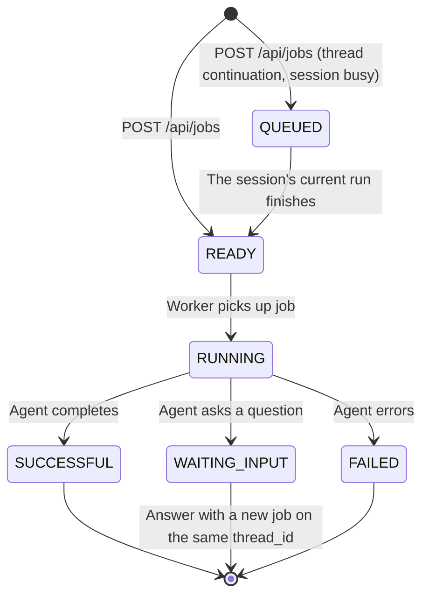

# Jobs API

The jobs API runs DAIV agents outside the git webhook flow. You send a prompt and a list of repositories, DAIV returns a job ID for each run, and you poll that ID for the result.

Use it to run agents from a CI pipeline, chain agent tasks, trigger runs from Slack bots, scripts or other tools, or start a one-off run with `curl`. To run a prompt on a recurring schedule without any external trigger, use [scheduled jobs](scheduled-jobs.md).

## Before you start

You need:

- A DAIV account with an API key, created as described in [Create an API key](#create-an-api-key).
- Write access to every repository you name in `repos`.
- For multi-repository sessions (`shared_session`), a daiv-sandbox release with path-scoped egress rules and repository seeding. Deploy the sandbox release first: with an older sandbox the run fails before any command runs, with an error that says so. Single-repository runs are unaffected.

## Create an API key

An API key belongs to one user and authenticates the jobs API and every other API surface, including the [MCP endpoint](mcp-endpoint.md#api-key-authentication), chat completions and the sessions API. Create it from the dashboard, or from the command line for headless provisioning.

!!! warning
    DAIV shows the full key once, when you create it, and cannot show it again. Copy it before you leave the page; if you lose it, revoke the key and create another.

To create a key in the dashboard:

1. Open the account menu at the bottom of the sidebar and select **API keys** (`/accounts/api-keys/`).
2. In **Create a new key**, enter a name, for example `CI/CD`.
3. Select **Create key**.
4. Select **Copy** next to **Your new API key**.

To create a key from the command line, run `django-admin` in the DAIV app container:

```bash
docker compose exec app django-admin create_api_key <username> --name "my-key"
```

Replace `<username>` with the username of the key's owner. The command prints the key once, in the form `prefix.secret`. For the `--expires-at` option and its time-zone rule, see [`create_api_key`](../reference/management-commands.md#create_api_key).

!!! warning
    Revoking a key cannot be undone. The key stops authenticating immediately on every API surface, so any script or client that uses it fails until you give it another key.

To stop a key from working, select **Revoke** next to it on the **API keys** page.

Admins see every user's keys; other users see their own.

## Authenticate a request

Pass the key as a Bearer token in the `Authorization` header of every request:

```bash
curl -X POST https://daiv.example.com/api/jobs \
  -H "Authorization: Bearer <api-key>" \
  -H "Content-Type: application/json" \
  -d '...'
```

Replace `<api-key>` with your key. A missing or invalid key returns `401`.

## Rate limiting

DAIV limits job submissions per authenticated user and returns `429 Too Many Requests` when you exceed the limit. The same budget applies to the [MCP endpoint](mcp-endpoint.md) and to chat completions. An admin sets the rate in **Configuration** under the **Jobs** group, or with `DAIV_JOBS_THROTTLE_RATE`; the default and the accepted formats are in [Environment variables](../reference/env-variables.md#jobs-api).

## Submit a job

Send a `POST` request to `/api/jobs` with a prompt and the repositories to run it on. For example:

```bash
curl -s -X POST https://daiv.example.com/api/jobs \
  -H "Authorization: Bearer $DAIV_API_KEY" \
  -H "Content-Type: application/json" \
  -d '{
    "repos": [{"repo_id": "mygroup/myproject"}],
    "prompt": "List all Python files and summarize the project structure"
  }'
```

DAIV answers `202 Accepted`:

```json
{
  "batch_id": "5b9e8a3c-9b7e-4c0d-a1f5-7e2c8d4b1a90",
  "jobs": [
    {
      "job_id": "1adfbf7a-917e-4f2e-8f54-17a27c006ec5",
      "repo_id": "mygroup/myproject",
      "ref": null,
      "thread_id": "9c1e8a3c-9b7e-4c0d-a1f5-7e2c8d4b1a90",
      "status": "READY"
    }
  ],
  "failed": []
}
```

Each entry in `jobs` is an independent run, so poll each `job_id` separately. Its `status` is `READY` when the run can start, or `QUEUED` when the session named by `thread_id` is busy; see [Job lifecycle](#job-lifecycle). DAIV reports a repository it rejects before enqueuing, such as an unknown `repo_id`, in `failed` as `{repo_id, ref, error}`, and still runs the rest of the batch.

For every field of the request, see [Request fields](#request-fields).

## Poll job status

Send a `GET` request to `/api/jobs/{job_id}`. DAIV answers `200 OK`:

```json
{
  "job_id": "1adfbf7a-917e-4f2e-8f54-17a27c006ec5",
  "status": "SUCCESSFUL",
  "thread_id": "9c1e8a3c-9b7e-4c0d-a1f5-7e2c8d4b1a90",
  "result": "Here are the Python files...",
  "merge_request_url": null,
  "artifacts": [
    {
      "id": "3f1c2b6e-0d7a-4f0e-9c4b-2a8d6e1f5b70",
      "title": "Dependency audit",
      "filename": "dependency-audit.html",
      "content_type": "text/html",
      "kind": "html",
      "size": 48213,
      "url": "https://daiv.example.com/dashboard/sessions/9c1e8a3c-9b7e-4c0d-a1f5-7e2c8d4b1a90/artifacts/3f1c2b6e-0d7a-4f0e-9c4b-2a8d6e1f5b70/",
      "download_url": "https://daiv.example.com/dashboard/sessions/9c1e8a3c-9b7e-4c0d-a1f5-7e2c8d4b1a90/artifacts/3f1c2b6e-0d7a-4f0e-9c4b-2a8d6e1f5b70/raw/?download=1"
    }
  ],
  "error": null,
  "created_at": "2026-03-27T18:22:39.012Z",
  "started_at": "2026-03-27T18:22:39.401Z",
  "finished_at": "2026-03-27T18:22:52.402Z"
}
```

`merge_request_url` holds the merge request DAIV opened when the agent committed and pushed code changes, and is `null` otherwise, for example on a read-only triage run. In a [multi-repository session](#multi-repository-sessions) it is the main repository's merge request, else the first one opened. `thread_id` identifies the thread the job ran on; pass it back as `thread_id` on a new submission to continue the conversation.

`artifacts` lists the files the agent published with its `publish_artifact` tool, such as reports, datasets and charts; see [Artifacts](sessions.md#artifacts). Each entry has the viewer page (`url`), a direct download (`download_url`), and a `kind` (`markdown`, `html`, `image`, `text` or `other`) that says how the viewer renders it. Opening either URL needs a signed-in DAIV user who can see the run. An artifact that a later job on the same thread revises keeps its ID and URLs, and appears under the job that first published it and under every job that revised it, with its current file ([Revise an artifact](sessions.md#revise-an-artifact)). The list is empty for a run that published nothing, and fills as the run progresses, so you can read it while the job is `RUNNING`. If DAIV cannot list the artifacts, `artifacts` is empty and `artifacts_error` says why; the rest of the status is unaffected.

`result` holds the agent's last response in full, not the rest of the run's messages. DAIV deletes a finished job's stored task result after 14 days, and from then on `result` holds the stored summary of the response, cut at 2,000 characters; the job's token usage and cost are kept. The MCP `get_job_status` tool behaves the same.

For the meaning of each `status`, see [Job status values](#job-status-values).

## Answer a question

When a job comes back `WAITING_INPUT`, the agent stopped to ask you a question instead of guessing. To answer it:

1. Read `question` for the questions asked, and `result` for their rendered text.
2. Send a new `POST /api/jobs` request with the same `thread_id` and your answer as `prompt`:

    ```bash
    curl -s -X POST https://daiv.example.com/api/jobs \
      -H "Authorization: Bearer $DAIV_API_KEY" \
      -H "Content-Type: application/json" \
      -d '{
        "repos": [{"repo_id": "mygroup/myproject"}],
        "prompt": "Use PostgreSQL.",
        "thread_id": "9c1e8a3c-9b7e-4c0d-a1f5-7e2c8d4b1a90"
      }'
    ```

3. Poll the new `job_id`. DAIV starts a new run that continues the agent's work from where it stopped.

The `thread_id` rules in [Request fields](#request-fields) apply to the answer too: `repos` has exactly one entry, or for a [multi-repository session](#continuing-a-multi-repository-session) the main repository alone or the session's full list, and the thread's most recent run must be yours.

You do not have to poll for the question. When a job ends in `WAITING_INPUT`, DAIV sends you a [notification](notifications.md) listing the questions, unless you muted it. For a multi-repository batch, the run counts in the batch rollup, and appears in the email and Rocket.Chat versions, once every repository's run has settled.

## Request fields

These are the fields of the `POST /api/jobs` body.

| Field                  | Type             | Required | Description |
|------------------------|------------------|----------|-------------|
| `repos`                | array of objects | yes      | 1–20 repositories to run against. Each item is `{ "repo_id": "group/project", "ref": "branch", "prompt": "..." }`. `ref` is optional, must be a branch that exists on the remote, and defaults to the repository's default branch. `prompt` is optional, must not be blank, and replaces the batch `prompt` for that repository only. A new merge or pull request targets `ref`, and DAIV assigns it to the API key's owner when their DAIV account is OAuth-linked to the git platform. |
| `prompt`               | string           | yes      | The prompt to send to the agent. It runs as an independent job against each repository in `repos`, except one that gives its own `prompt`, and it titles the batch. |
| `agent_model`          | string           | no       | The model for this batch. DAIV rejects an invalid model and thinking-level combination with `400`. |
| `agent_thinking_level` | string           | no       | The agent's reasoning effort: `minimal`, `low`, `medium`, `high` or `xhigh`. DAIV rejects an invalid combination with `400`. |
| `muted`                | boolean          | no       | Mute notifications for every job in this batch. Default `false`. |
| `environment`          | string           | no       | The [sandbox environment](sandbox-environments.md), by name or ID, for every job in the batch. DAIV rejects an environment it cannot resolve with `400`. |
| `shared_session`       | boolean          | no       | Run all repositories in `repos` in one session instead of one job each. At most 5 entries. See [Multi-repository sessions](#multi-repository-sessions). |
| `thread_id`            | string (UUID)    | no       | Continue an existing thread. `repos` must hold exactly one entry (a [multi-repository session](#continuing-a-multi-repository-session) also accepts its full list), the thread's most recent run must be yours, and the session must not be [archived](sessions.md#archived-sessions); otherwise DAIV returns `400`. If the session is busy, the job joins the session's next run for its branch in `QUEUED` state, which starts once the current run ends; see [Job lifecycle](#job-lifecycle). |
| `references`           | array of objects | no       | Up to 20 external work-item references, such as Jira, Sentry or RT tickets and git platform issues, that DAIV links into the merge or pull request it creates. Each item is `{ "key": "PROJ-123", "url": "https://…", "provider": "jira", "relation": "relates" }`, and only `key` is required. The per-field rules are in [References](mcp-endpoint.md#references); DAIV rejects an invalid reference with `422` and stores nothing. |
| `mcp_overrides`        | object           | no       | MCP servers to switch on or off for every job in the batch, relative to the default set: `{"grafana": true}` adds an on-demand server, `{"sentry": false}` drops an active one. Names are those of the global servers and your own personal ones. DAIV rejects an unknown name with `400`, and a value other than `true` or `false` with `422`. On a continued thread (`thread_id`) the overrides apply on top of the thread's own, so a server you do not name keeps its setting. DAIV returns a continuation that would change them while another run on the thread is unfinished in `failed`, since that run would pick them up too. |

DAIV validates the body strictly and rejects unknown fields with `422`, `use_max` and `notify_on` included. Use `muted` to silence notifications, and `agent_model` and `agent_thinking_level` to choose the model.

## Job status values

| Status | Meaning |
|--------|---------|
| `QUEUED` | The job is the session's next run, waiting for its current run to finish. Only occurs for thread continuations (`thread_id` supplied). |
| `READY` | The job is waiting for a worker. |
| `RUNNING` | The agent is executing. |
| `SUCCESSFUL` | The run completed, and `result` holds the agent's last response. |
| `WAITING_INPUT` | The agent stopped to ask you a question. This is a final state, not a step towards `SUCCESSFUL`. `question` holds the questions asked, and `result` their rendered text. |
| `FAILED` | The agent hit an error, and `error` holds a message. |

## Error responses

For `GET /api/jobs/{job_id}`:

| Code | When |
|------|------|
| `401` | The API key is missing or invalid. |
| `404` | The job ID is not found or is not a valid ID. |

For `POST /api/jobs`:

| Code | When |
|------|------|
| `400` | The request is invalid: a bad `agent_model` or `agent_thinking_level`; no `agent_model` given and no system default model configured (a model set only in `.daiv.yml` does not count); an unresolvable `environment`; an unknown MCP server in `mcp_overrides`; an invalid `shared_session` list (more than 5 entries, a repository listed twice, or a per-repository `prompt`); or an invalid `thread_id` continuation (an unknown or unowned thread, an archived session, more than one repository for a single-repository session, a `ref` on a multi-repository session, or anything but the main repository alone or the full list in order). |
| `401` | The API key is missing or invalid. |
| `404` | A repository in `repos` is not found, or you lack write access to it. The response does not say which one. |
| `422` | The body is malformed or has unknown fields, for example `use_max` or `notify_on`, or a `references` entry is invalid. |
| `429` | You exceeded the [rate limit](#rate-limiting). |

## Multi-repository sessions

By default, several entries in `repos` fan out into independent jobs, one session per repository. To let the agent work across repositories in one conversation, for example a backend change and the client that consumes it, set `shared_session: true`:

```json
{
  "repos": [
    {"repo_id": "mygroup/backend"},
    {"repo_id": "mygroup/client", "ref": "develop"}
  ],
  "shared_session": true,
  "prompt": "Add a `locale` field to the profile endpoint and use it in the client."
}
```

- You can also start such a session from the dashboard chat, which takes the same list: see [Start a chat over several repositories](sessions.md#start-a-chat-over-several-repositories).
- `repos` takes up to 5 entries, the first being the main one, each repository at most once, and no per-repository `prompt`: the session runs the one `prompt`.
- The response holds one job and one `thread_id`. The job's `repo_id` is the first entry, the main repository.
- You need write access to every repository. If one is missing or unknown, the call fails with the usual opaque `404`.
- The main repository's `.daiv.yml`, model, sandbox environment, skills, subagents and [memory](memory.md) drive the session. DAIV checks it out at `/workspace/repo` and the others at `/workspace/repos/<repository path>`. The agent is told about them and reads their `AGENTS.md`.
- The agent reads the main repository's memory, but a multi-repository run adds no observations to it, since its transcript holds the other repositories' code.

### Merge requests

At the end of each turn, every repository that changed gets its own commit, branch and merge request. Unchanged repositories get nothing, and one repository failing to publish does not stop the others. Each merge request's description lists the session's other merge requests as platform references (`group/project!12`, `owner/repo#12`), which the platform links and titles only for readers who can see that repository. External references, such as a support ticket, go into every merge request, but only the main repository's closes them; the others relate to them. GitLab or GitHub issue references go only into the main repository's.

The job status adds two lists:

| Field | Meaning |
|-------|---------|
| `merge_requests` | `[{"repo_id": "...", "url": "..."}]`, one per opened or updated merge request. |
| `publish_errors` | `[{"repo_id": "...", "error": "..."}]`, one per repository that could not be published. |

`merge_request_url` stays: the main repository's merge request, else the first one opened.

### Continuing a multi-repository session

Pass the session's `thread_id`. `shared_session` is optional and ignored, because the session decides whether a continuation is shared: a single-repository session continues as one even with `shared_session: true`. Send the main repository alone, or the identical list in the same order, and no `ref`. Anything else returns `400`. Each repository continues on its stored working branch. If that branch is gone because its merge request was merged, the repository falls back to its default branch and opens a new merge request the next time it changes.

### Visibility and CI

A multi-repository session, with its runs, transcript, artifacts and merge request links, is visible only to its owner, admins, and users who can read every repository in it.

The session owns every merge request it opens, the main repository's and each other repository's, so their [CI watch](pipeline-watch.md) results and `@daiv` comments reach the session's [inbox](sessions.md#the-session-inbox). The session's next run handles a CI failure or a mention on any of them, on the main repository's branch with every repository checked out, and DAIV answers a mention on the merge request it was made on. Each merge request has its own CI fix attempts. In the dashboard, a multi-repository session continued in chat keeps all its repositories and its main repository cannot be switched, and the session page lists every repository and merge request.

## Job lifecycle

A job moves through these statuses:

1. `POST /api/jobs` creates the job as `READY`, or as `QUEUED` when you supply a `thread_id` and the session is busy.
2. A `QUEUED` job becomes `READY` when the session's current run finishes.
3. A worker picks up a `READY` job and it becomes `RUNNING`.
4. A `RUNNING` job ends as `SUCCESSFUL` when the agent completes, `WAITING_INPUT` when the agent asks a question, or `FAILED` when the agent errors.
5. A `WAITING_INPUT` job does not change. Your answer is a new job: `POST /api/jobs` with the same `thread_id` and your answer as `prompt`. It starts at `READY`, or at `QUEUED` when the session is busy.



A job starts in `QUEUED` only when you supply a `thread_id` and the session is busy. The job then joins the session's next run for its branch (`ref`, or the session's branch when you leave it out), which starts at `READY` once the current run ends. Everything waiting for the session on that branch goes into the same run: another job, a chat message, a CI failure DAIV is fixing. So two jobs sent while the session is busy can return the same `job_id`; poll it once and read one `result` for both. A job on a different branch gets a next run of its own. Every other submission starts at `READY`.

`SUCCESSFUL`, `WAITING_INPUT` and `FAILED` are final for that job. `WAITING_INPUT` does not progress to `SUCCESSFUL` on its own; it waits for a new job on the same thread (see [Answer a question](#answer-a-question)).

## Examples

### Poll from a shell script

Replace `<api-key>` with your DAIV API key before you run the script.

```bash
#!/bin/bash
DAIV_URL="https://daiv.example.com"
API_KEY="<api-key>"

# Submit (single-repo batch)
JOB_ID=$(curl -s -X POST "$DAIV_URL/api/jobs" \
  -H "Authorization: Bearer $API_KEY" \
  -H "Content-Type: application/json" \
  -d '{"repos":[{"repo_id":"mygroup/myproject"}],"prompt":"List all TODO comments"}' \
  | jq -r '.jobs[0].job_id')

echo "Job submitted: $JOB_ID"

# Poll until done
while true; do
  RESPONSE=$(curl -s "$DAIV_URL/api/jobs/$JOB_ID" \
    -H "Authorization: Bearer $API_KEY")
  STATUS=$(echo "$RESPONSE" | jq -r '.status')

  case "$STATUS" in
    SUCCESSFUL) echo "$RESPONSE" | jq -r '.result'; break ;;
    FAILED)     echo "Job failed"; exit 1 ;;
    *)          sleep 10 ;;
  esac
done
```

### Chain two jobs in a scheduled GitLab pipeline

This job in a scheduled GitLab CI pipeline triages support tickets, then creates issues from the report:

```yaml
# .gitlab-ci.yml
triage-and-create-issues:
  rules:
    - if: $CI_PIPELINE_SOURCE == "schedule"
  script:
    # Step 1: Triage tickets
    - |
      JOB_ID=$(curl -s -X POST "$DAIV_URL/api/jobs" \
        -H "Authorization: Bearer $DAIV_API_KEY" \
        -H "Content-Type: application/json" \
        -d '{
          "repos": [{"repo_id": "mygroup/myproject"}],
          "prompt": "Triage the RT queue and identify code-related tickets. Return a summary with ticket IDs, descriptions, and priorities."
        }' | jq -r '.jobs[0].job_id')

    # Step 2: Poll until done
    - |
      while true; do
        STATUS=$(curl -s "$DAIV_URL/api/jobs/$JOB_ID" \
          -H "Authorization: Bearer $DAIV_API_KEY" | jq -r '.status')
        [ "$STATUS" = "SUCCESSFUL" ] && break
        [ "$STATUS" = "FAILED" ] && exit 1
        sleep 30
      done
      TRIAGE=$(curl -s "$DAIV_URL/api/jobs/$JOB_ID" \
        -H "Authorization: Bearer $DAIV_API_KEY" | jq -r '.result')

    # Step 3: Chain — create issues from the triage report
    - |
      curl -s -X POST "$DAIV_URL/api/jobs" \
        -H "Authorization: Bearer $DAIV_API_KEY" \
        -H "Content-Type: application/json" \
        -d "$(jq -n --arg prompt "Based on this triage report, create GitLab issues for each actionable item: $TRIAGE" \
          '{repos: [{repo_id: "mygroup/myproject"}], prompt: $prompt}')"
```

Store `DAIV_URL` and `DAIV_API_KEY` as CI/CD variables in your GitLab project settings, and turn on **Mask variable** and **Protect variable** for the API key.

## Related pages

- [Request Tracker triage](../integrations/rt/index.md): an end-to-end example of using the jobs API from an RT Scrip to triage new support tickets.
- [MCP endpoint](mcp-endpoint.md): the same submission and polling through an MCP client.
- [Scheduled jobs](scheduled-jobs.md): recurring runs without an external trigger.
