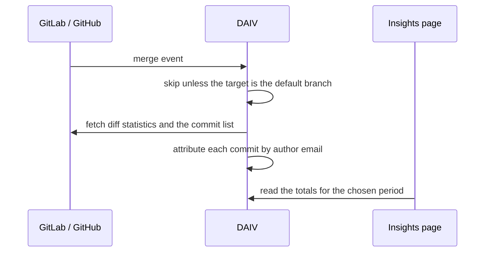

# Merge metrics

DAIV records every merge request (GitLab) or pull request (GitHub) merged into a default branch. For each merge it counts the lines changed and attributes them to DAIV or to people, commit by commit. The dashboard's **Insights** page shows the totals as code velocity.

---

## How it works

The steps below give the same flow in text.

1. **DAIV receives a merge event.** GitLab sends a `merge_request` webhook with `action: merge`; GitHub sends a `pull_request` webhook with `action: closed` and `merged: true`.
2. **DAIV checks the target branch.** It records only merges into the repository's default branch, and ignores merges into feature or release branches.
3. **DAIV fetches the data.** A background task fetches the merge's diff statistics and its commit list from the platform API.
4. **DAIV attributes the lines.** It compares each commit's author email with DAIV's bot commit email, and splits the lines added and removed into DAIV's and people's.
5. **DAIV shows the totals.** The **Code velocity** section of the **Insights** page uses the same period filter as the agent activity counters: **Today**, **7 days**, **30 days**, **90 days** or **All time**, with **7 days** as the default.

If a platform call fails, DAIV still records the merge. When only the diff statistics fail, DAIV takes the lines changed from the sum over the commits; a figure whose own fetch failed stays at zero.

---

## Code velocity metrics

Everyone sees the **Code velocity** section, counted over the repositories they can read (administrators: every repository). It stays hidden when the period has no merges. The period filter at the top of the page applies to every figure.

| Figure on the page | What it counts |
|--------|-------------|
| **merges** | Merge and pull requests merged into default branches |
| **involved DAIV** | The share of merges with at least one DAIV-authored commit, with both counts |
| **of commits by DAIV** | The share of commits authored by DAIV, with both counts |
| **lines changed** | Lines added and removed across all merges |
| **Merges over time** | Merges per day (per week for 30 and 90 days, per month for all time), split into those that involved DAIV and those by people only. Hidden for **Today** |

---

## Attribution

DAIV identifies its own commits by matching the commit author email against its bot email:

- **GitLab:** the bot user's `commit_email`, else its `public_email`, else its `email`, else `<username>@users.noreply.gitlab.com`
- **GitHub:** `<user_id>+<app_slug>[bot]@users.noreply.github.com`

### Mixed authorship

A merge request can hold commits from both DAIV and people. When a person opens one and then asks DAIV for follow-up changes with `@daiv`, DAIV splits the lines by each commit's author.

### Commit limits

On GitLab, DAIV attributes the first 100 commits of a merge request. On GitHub, the platform lists at most 250 commits per pull request.

### Squash merges

A squash merge collapses the commits into one on the target branch, but the platform API keeps the original commit list. DAIV attributes lines from that list, so squash merges are attributed like any other.

---

## Turn on merge metrics

Merge metrics need no configuration: DAIV records merges as soon as it receives merge events.

- **GitLab:** DAIV registers `merge_requests_events` on each repository's webhook when it creates it. To add the event to webhooks registered earlier, run `docker compose exec app django-admin setup_webhooks --update`; see [`setup_webhooks`](../reference/management-commands.md#setup_webhooks).
- **GitHub:** DAIV registers nothing. Subscribe your GitHub App to **Pull request**; [Platform setup](../getting-started/platform-setup.md#github-app-permissions-and-events) lists every event the App needs.

## Related pages

- [Sessions](sessions.md) — the run history behind the DAIV-authored commits these metrics attribute
- [Issue addressing](issue-addressing.md) — the workflow that produces most DAIV-authored merges
