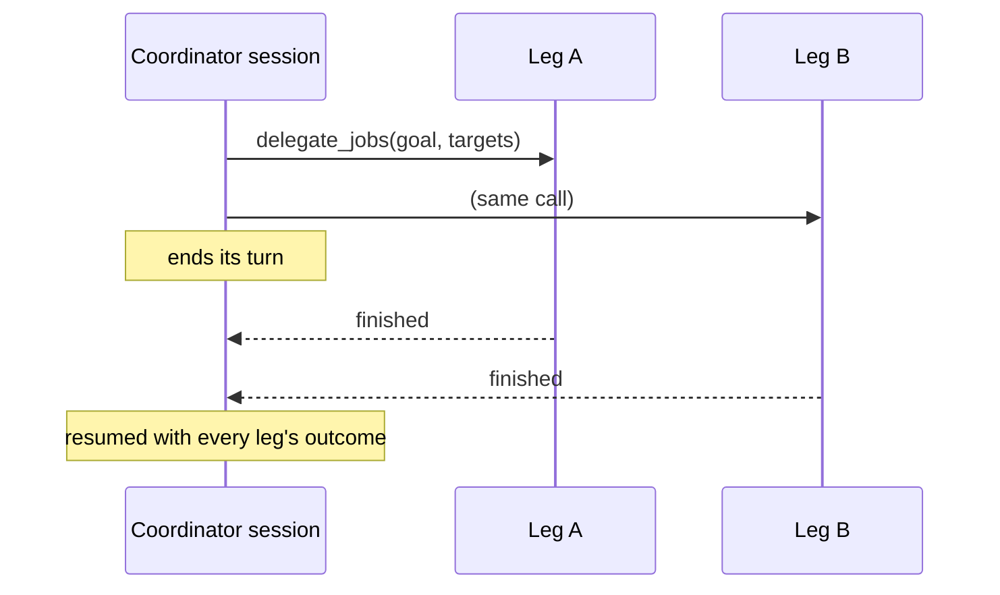

# Orchestration

Orchestration lets the agent hand work to new, independent jobs — on your other repositories or on its own — and pick up again once they have all finished, to report the combined outcome or carry on.

Use it to:

- **Coordinate multi-repository changes** — bump a shared library in every service that depends on it.
- **Route tickets** — read an issue queue and dispatch each ticket to the repository that owns it.
- **Fix findings one by one** — triage Sentry, then open one fix per finding, each in its own merge request.
- **Split off a side fix** — while working on a task, hand an unrelated problem you agreed to fix to a job of its own.

## How it works

When orchestration is on, the agent gets a `delegate_jobs` tool. It takes a one-line `goal` and up to 10 targets, each a repository (another one, or the agent's own), an optional branch and a **prompt written for that target**. DAIV starts one independent job per target (a *leg*), and the coordinator ends its turn.

Each leg is an ordinary agent job in a session of its own: a fresh clone, its own context and budget, and its repository's `.daiv.yml`, skills and sandbox environment. A leg always publishes to **a new branch and merge request of its own**, even when the branch it starts from already has an open merge request, so legs never push onto each other's work or onto yours.

When the last leg finishes, DAIV queues a new run on the coordinator's session — a *Delegation Resume* run — whose prompt lists every leg's outcome, branch, merge request and reply. If the coordinator is still busy — its turn has not ended, or a chat turn or another run started on its session meanwhile — the resumed run waits for that run to finish, then starts from the branch that run left the session on. The coordinator picks up from there: it checks the results, reports them where the request came from (a comment on the ticket, for example), merges a leg's branch into its own, or delegates another batch. The resumed run can stop to ask a question like any other job, unless the coordinator's session was started by a schedule or a CI watch, where nobody is around to answer.



Nothing polls while the legs run: the coordinator holds no worker and spends no tokens until it is resumed.

When a leg comes back incomplete or wrong, the coordinator does not have to start over: a target that names the leg's session id (`thread_id`) is a **leg follow-up**. It continues that leg in its own session, with its earlier conversation, on its branch and merge request, so the fix lands where the leg's work already is. A leg follow-up joins the batch of the call that sent it, alongside any new legs, and the coordinator is resumed once all of them have finished.

## Turning it off

Orchestration is **on by default** on every repository. Turn it off in the `.daiv.yml` of a repository whose agent should never split work off:

```yaml
orchestration:
  enabled: false
```

A repository needs no configuration to *receive* delegated work; a leg is a normal job.

## Where a leg's work lands

A target's `ref` is the branch the leg starts from and the branch its merge request targets:

- **Omit it** for the repository's default branch: the leg's change stands on its own, in a merge request against the default branch.
- **Give the coordinator's current branch** to build on its work, even when that is the default branch: such a leg **starts once the coordinator's turn ends**, from the branch that turn published to, so it sees everything the turn changed and its merge request targets that branch. When the coordinator is resumed it can merge the leg's branch into its own, or leave the leg's merge request for review.

## Following up a leg

Each leg in the resume names its session id. To fix or extend a leg's own work — its tests still fail, a reviewer asked for a change, its reply leaves a question open — the coordinator follows it up: it calls `delegate_jobs` with a target that has the leg's `thread_id`, its `repo_id`, no `ref`, and a prompt saying what to do next. For work that stands apart from every leg's, it delegates a new leg instead.

A leg follow-up:

- **Works where the leg's work is.** It runs in the leg's session, with the leg's earlier conversation, and pushes to the leg's branch and merge request, even one a reviewer approved or set to merge when its pipeline passes: your platform's approval rules decide whether that push resets the approvals. A leg that published nothing opens a branch and merge request of its own, as a new leg would, never the branch it started from.
- **Waits its turn.** When the leg's session is busy — fixing CI on its merge request, or answering a person's chat — the leg follow-up waits in its inbox, as **Leg follow-up**, until the session is free. It then runs alone, never in the same run as other waiting requests, and sees what happened meanwhile (a push to the branch, for example) as context.
- **Runs once.** It is never retried: if its run fails, the batch reports it as failed and the coordinator decides whether to send another.
- **Stops when its merge request is gone.** If the leg's merge request was merged or closed while the leg follow-up waited, it stops when it would start, without changing anything, and the coordinator reads *not run: its merge request was merged* (or *closed*) with the advice to delegate a new leg.

It runs as the user who triggered the coordinator's run, keeps the coordinator's mute and cannot ask questions, like a leg. That user's repository access is checked when it is sent, as for a new leg, and again when its run starts: one refused there is reported as failed.

## Following and cancelling the legs

Between resumes, the coordinator has two more tools:

- `check_delegated_jobs` reports where its batches stand: each leg's status (`queued`, `running`, `stopping`, `succeeded`, `failed`, `cancelled`, or *not run* for a leg follow-up whose merge request was merged or closed), session, branch, merge request and reply. Given a `batch_id` it reports that batch, with replies up to 4,000 characters; without one, the session's five latest, with replies up to 1,000. The agent uses it when you ask how the work is going, never to wait for the legs: the resume comes on its own.
- `cancel_delegated_jobs` cancels a batch's unfinished legs, or only the ones it names by `thread_id`, leg follow-ups included. A queued leg never starts, and cancelling a waiting leg follow-up leaves every other request waiting on the leg's session in place. A running leg shows as `stopping` until it stops, within about ten seconds, and may push to its branch or open a merge request before then. If it finishes first, it keeps its outcome. A cancelled leg's session shows it as stopped, and [Notifications](notifications.md) count it as failed.

The agent cancels when you ask it to, or when the work a leg does is no longer wanted. The coordinator is still resumed once the batch has finished, with the cancelled legs marked as such, unless every leg was cancelled: then no resume comes.

## Choosing between `task` and `delegate_jobs`

| Use | When |
|-----|------|
| [Subagents](subagents.md) (`task`) | Focused or parallel work that fits in the current turn and the current workspace. Subagents share the run's working tree and report back within the turn. |
| `delegate_jobs` on the same repository | Work too big for one turn, or a separate change that deserves its own merge request. |
| `delegate_jobs` on other repositories | Work that belongs there. |

## Writing the prompts

A leg sees only its own prompt — not the coordinator's conversation, the ticket, or anything the coordinator looked up. Each target's prompt must therefore carry everything that leg needs, and should end with the no-change convention: *"If there is nothing to change, reply saying so and make no changes."*

A target can also carry `references`, linked into the leg's merge request like the [Jobs API](jobs-api.md)'s; `relation: closes` resolves the issue on merge where the provider supports it.

```json
{
  "goal": "Apply the CVE-2026-12345 patch",
  "targets": [
    { "repo_id": "mygroup/service-auth", "prompt": "Bump the auth library to 3.2.1 (CVE-2026-12345). If there is nothing to change, reply saying so and make no changes." },
    { "repo_id": "mygroup/service-api", "ref": "release/2.x", "prompt": "Update the auth dependency to 3.2.1 and fix any breaking import. If there is nothing to change, reply saying so and make no changes." }
  ]
}
```

The `goal` only titles the batch; it is never sent to a leg.

## Rules and limits

| Rule | Why |
|------|-----|
| At most **10 targets** per call, leg follow-ups included | Split larger fan-outs across calls. |
| **One level deep** | A leg gets no `delegate_jobs` tool, even on a repository with orchestration on, nor does a leg follow-up's run. |
| **One leg follow-up outstanding per leg** | A leg still working — on its first run, a leg follow-up, or waiting for the coordinator's turn — is refused a leg follow-up; the coordinator is resumed when it finishes and can follow it up then. A call that names one leg twice is refused as a whole. |
| A leg follow-up names a leg of its own coordinator, its repository and no branch | Otherwise that target is refused with what to do instead, and the call's other targets still start. An archived leg, one DAIV lost track of, and one whose merge request was merged or closed are refused too. |
| A leg follow-up always wakes the leg | Even at the leg's limit of runs in a row nobody asked for; its run still counts toward that limit, so CI fixes after it stay limited. |
| Replies up to **4,000 characters** | The resume and the status of one batch show each leg's reply from its full final answer up to 4,000 characters, the overview of the latest batches up to 1,000; a cut reply says so and points to the leg's session. |
| Every leg forks its own branch | Any number of legs may start from the same branch, the coordinator's own included; each opens its own merge request. |
| A leg given the coordinator's current branch waits for its turn to end | So it starts from what the coordinator published, which is a new branch when the coordinator started on the default branch. A leg that omits `ref` starts at once. |
| Legs run as the user who triggered the coordinator's run | Targets that user cannot write to come back as failures; the rest still start. A run with no DAIV user behind it (e.g. a mention from an account not linked to DAIV) cannot delegate. The resumed run runs as the same user, and fails instead of starting if that user can no longer write to the coordinator's repository. |
| Legs cannot ask questions | Nobody is watching a leg, so it decides or reports instead of stopping for input. |
| Legs and the resumed run keep the coordinator's mute | A muted job or schedule stays quiet through its delegations. |
| Only the coordinator's session can check or cancel its legs | The tools see the batches their own session delegated, and no other session's. |
| At most **3 runs in a row** nobody asked for | After three runs in a row on the coordinator's session that no person started, a finished batch is only remembered instead of resuming it, until a person starts a run there, and its owner is told, so failing legs cannot loop it. |

If no target starts, the tool says so and no resume comes: the coordinator deals with the failures in the same turn. If the resumed run cannot be queued when the last leg finishes, or gives up waiting for the coordinator's session, DAIV retries it within a few minutes, and it starts any leg left waiting after the coordinator's turn ended.

The resumed run's summary never quotes DAIV's own error text, so the coordinator cannot post it on a public ticket: a leg that failed on DAIV's side links to its session instead.

## Recipes

### Ticket triage across repositories

A coordination repository can hold no production code at all and act as a routing hub:

1. **Attach your ticketing system** as an [MCP server](../customization/mcp-tools.md) (Jira, Linear, Request Tracker, …), so the coordinator can read tickets and comment on them.
2. **Write the routing rules in its `AGENTS.md`**:

    ```markdown
    # Routing rules

    - Tickets tagged `backend` → mygroup/service-api
    - Tickets tagged `frontend` → mygroup/service-web
    - Unclassified tickets → skip, comment "needs triage label"
    ```

3. **Trigger it** with a [Scheduled Job](scheduled-jobs.md) that polls the queue, or from your ticketing system through the [Jobs API](jobs-api.md):

    ```
    Fetch the open tickets not yet dispatched. Route each one with the rules in AGENTS.md and delegate one
    target per ticket. When the legs finish, comment the merge request links on each ticket.
    ```

### One fix per Sentry finding

With orchestration on in the application's own repository and the Sentry [MCP server](../customization/mcp-tools.md) enabled, a single prompt — run by hand or from a [Scheduled Job](scheduled-jobs.md) — triages and fans out:

```
Triage the unresolved Sentry issues of the last 24 hours. For each one worth fixing, delegate a fix on this
repository's default branch, with the issue's details in the prompt and the issue in `references` with
relation `closes`. When the fixes finish, summarise what was fixed and what was left alone, with links.
```

Each fix opens its own merge request against the default branch, linked to its Sentry issue.

### A side fix during a task

While the agent works on a task in chat, it may come across an unrelated problem. It proposes the fix; once you agree, it delegates it, either on the default branch for a merge request of its own, or on the task's branch to merge it into the task. Either way the task's session carries on, and the agent tells you where the fix landed when the leg finishes.

## Seeing the batch

Every leg is its own session in the [Sessions](sessions.md) list, and the legs of one call share a batch. The coordinator's session page shows where each leg stands now, not where it stood when it was delegated:

- **Transcript** — each `delegate_jobs` call is a **Delegated jobs** card: its goal, and one row per leg with its state, merge request and session.
- **Sidebar** — the **Delegated jobs** section of the **Info** tab lists the legs batch by batch, newest first.

A leg is *Queued*, *Starts after this turn*, *Running*, *Stopping*, *Finished*, *Failed*, *Cancelled*, *Lost* (it started, but DAIV lost track of it), or *Not run: merge request merged* / *closed* (a leg follow-up that stopped at its start). A leg that served several batches, through leg follow-ups, is listed under each batch and counted once in the **Delegated jobs** count, and the call card marks a leg follow-up's row as **Leg follow-up**. An open page updates within a few seconds of a leg starting or finishing. In both places, a leg whose session you cannot see shows only its repository, branch and state. A leg's own session page links back to the coordinator's (**Delegated by**) when you can see it.

The coordinator's session then shows the resumed run with the legs' summary. [Notifications](notifications.md) treat the legs as a batch, so you get one rollup when they need a look.

!!! note "Why not call DAIV's own MCP endpoint?"
    [`submit_job`](mcp-endpoint.md) starts the same kind of jobs, but a caller can only poll or block for the result. That suits an editor or a script; inside an agent run it would hold a worker while the legs wait for one, with no way to resume afterwards. `delegate_jobs` ends the coordinator's turn and resumes it when the work is done.

## See also

- [Repository Config](../customization/repository-config.md) — the `orchestration` toggle
- [Jobs API](jobs-api.md) and [MCP Endpoint](mcp-endpoint.md) — a batch can also give each repository its own `prompt`
- [Subagents](subagents.md) — parallel work inside one turn
