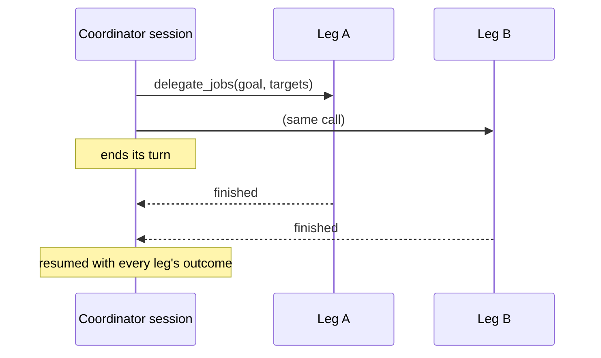

# Orchestration

Orchestration lets the agent hand work to new, independent jobs — on your other repositories or on its own — and pick up again once they have all finished, to report the combined outcome or carry on.

Use it to:

- **Coordinate multi-repository changes** — bump a shared library in every service that depends on it.
- **Route tickets** — read an issue queue and dispatch each ticket to the repository that owns it.
- **Fix findings one by one** — triage Sentry, then open one fix per finding, each in its own merge request.
- **Split off a side fix** — while working on a task, hand an unrelated problem you agreed to fix to a job of its own.

## How it works

When orchestration is on, the agent gets a `delegate_jobs` tool. It takes a one-line `goal` and up to 10 targets, each a repository (another one, or the agent's own), an optional branch and a **prompt written for that target**. DAIV starts one independent job per target (a *leg*), and the coordinator ends its turn.

Each leg is an ordinary agent job in a session of its own: a fresh clone, its own context and budget, and its repository's `.daiv.yml`, skills and sandbox environment. A leg always publishes to **a new branch and merge request of its own**, even when the branch it starts from already has an open merge request, so legs never push onto each other's work or onto yours.

When the last leg finishes, DAIV queues a new run on the coordinator's session — a *Delegation Resume* run — whose prompt lists every leg's outcome, branch, merge request and reply. If the coordinator is still busy — its turn has not ended, or a chat turn or another run started on its session meanwhile — the resumed run waits for that run to finish, then starts from the branch that run left the session on. The coordinator picks up from there: it checks the results, reports them where the request came from (a comment on the ticket, for example), merges a leg's branch into its own, or delegates another batch. The resumed run can stop to ask a question like any other job, unless the coordinator's session was started by a schedule or a CI watch, where nobody is around to answer.



Nothing polls while the legs run: the coordinator holds no worker and spends no tokens until it is resumed.

## Turning it on

Orchestration is **off by default**. Turn it on in the `.daiv.yml` of the repository whose agent should delegate — a coordination repository, or any repository where you want it to split work off:

```yaml
orchestration:
  enabled: true
```

A repository needs no configuration to *receive* delegated work; a leg is a normal job.

## Where a leg's work lands

A target's `ref` is the branch the leg starts from and the branch its merge request targets:

- **Omit it** for the repository's default branch: the leg's change stands on its own, in a merge request against the default branch.
- **Give the coordinator's current branch** to build on its work, even when that is the default branch: such a leg **starts once the coordinator's turn ends**, from the branch that turn published to, so it sees everything the turn changed and its merge request targets that branch. When the coordinator is resumed it can merge the leg's branch into its own, or leave the leg's merge request for review.

## Following and cancelling the legs

Between resumes, the coordinator has two more tools:

- `check_delegated_jobs` reports where its batches stand: each leg's status (`queued`, `running`, `succeeded`, `failed` or `cancelled`), session, branch, merge request and reply. Given a `batch_id` it reports that batch; without one, the session's five latest. The agent uses it when you ask how the work is going, never to wait for the legs: the resume comes on its own.
- `cancel_delegated_jobs` cancels a batch's unfinished legs, or only the ones it names by `thread_id`. A queued leg never starts. A running leg stops within about ten seconds, and may already have pushed to its branch or opened a merge request. A cancelled leg's session shows it as failed, with the reason, and [Notifications](notifications.md) count it as failed.

The agent cancels when you ask it to, or when the work a leg does is no longer wanted. The coordinator is still resumed once the batch has finished, with the cancelled legs marked as such, unless every leg was cancelled: then no resume comes.

## Choosing between `task` and `delegate_jobs`

| Use | When |
|-----|------|
| [Subagents](subagents.md) (`task`) | Focused or parallel work that fits in the current turn and the current workspace. Subagents share the run's working tree and report back within the turn. |
| `delegate_jobs` on the same repository | Work too big for one turn, or a separate change that deserves its own merge request. |
| `delegate_jobs` on other repositories | Work that belongs there. |

## Writing the prompts

A leg sees only its own prompt — not the coordinator's conversation, the ticket, or anything the coordinator looked up. Each target's prompt must therefore carry everything that leg needs, and should end with the no-change convention: *"If there is nothing to change, reply saying so and make no changes."*

A target can also carry `references`, linked into the leg's merge request like the [Jobs API](jobs-api.md)'s; `relation: closes` resolves the issue on merge where the provider supports it.

```json
{
  "goal": "Apply the CVE-2026-12345 patch",
  "targets": [
    { "repo_id": "mygroup/service-auth", "prompt": "Bump the auth library to 3.2.1 (CVE-2026-12345). If there is nothing to change, reply saying so and make no changes." },
    { "repo_id": "mygroup/service-api", "ref": "release/2.x", "prompt": "Update the auth dependency to 3.2.1 and fix any breaking import. If there is nothing to change, reply saying so and make no changes." }
  ]
}
```

The `goal` only titles the batch; it is never sent to a leg.

## Rules and limits

| Rule | Why |
|------|-----|
| At most **10 targets** per call | Split larger fan-outs across calls. |
| **One level deep** | A leg gets no `delegate_jobs` tool, even on a repository with orchestration on, so a leg's run is its whole answer. |
| Every leg forks its own branch | Any number of legs may start from the same branch, the coordinator's own included; each opens its own merge request. |
| A leg given the coordinator's current branch waits for its turn to end | So it starts from what the coordinator published, which is a new branch when the coordinator started on the default branch. A leg that omits `ref` starts at once. |
| Legs run as the user who triggered the coordinator's run | Targets that user cannot write to come back as failures; the rest still start. A run with no DAIV user behind it (e.g. a mention from an account not linked to DAIV) cannot delegate. The resumed run runs as the same user, and fails instead of starting if that user can no longer write to the coordinator's repository. |
| Legs cannot ask questions | Nobody is watching a leg, so it decides or reports instead of stopping for input. |
| Legs and the resumed run keep the coordinator's mute | A muted job or schedule stays quiet through its delegations. |
| Only the coordinator's session can check or cancel its legs | The tools see the batches their own session delegated, and no other session's. |
| At most **3 resumes in a row** may delegate again | A coordinator resumed three times in a row by its own delegations, with no other run on its session in between, finishes in that turn instead of delegating again, so failing legs cannot loop it. |

If no target starts, the tool says so and no resume comes: the coordinator deals with the failures in the same turn. If the resumed run cannot be queued when the last leg finishes, or gives up waiting for the coordinator's session, DAIV retries it within a few minutes, and it starts any leg left waiting after the coordinator's turn ended.

The resumed run's summary never quotes DAIV's own error text, so the coordinator cannot post it on a public ticket: a leg that failed on DAIV's side links to its session instead.

## Recipes

### Ticket triage across repositories

A coordination repository can hold no production code at all and act as a routing hub:

1. **Attach your ticketing system** as an [MCP server](../customization/mcp-tools.md) (Jira, Linear, Request Tracker, …), so the coordinator can read tickets and comment on them.
2. **Write the routing rules in its `AGENTS.md`**:

    ```markdown
    # Routing rules

    - Tickets tagged `backend` → mygroup/service-api
    - Tickets tagged `frontend` → mygroup/service-web
    - Unclassified tickets → skip, comment "needs triage label"
    ```

3. **Trigger it** with a [Scheduled Job](scheduled-jobs.md) that polls the queue, or from your ticketing system through the [Jobs API](jobs-api.md):

    ```
    Fetch the open tickets not yet dispatched. Route each one with the rules in AGENTS.md and delegate one
    target per ticket. When the legs finish, comment the merge request links on each ticket.
    ```

### One fix per Sentry finding

With orchestration on in the application's own repository and the Sentry [MCP server](../customization/mcp-tools.md) enabled, a single prompt — run by hand or from a [Scheduled Job](scheduled-jobs.md) — triages and fans out:

```
Triage the unresolved Sentry issues of the last 24 hours. For each one worth fixing, delegate a fix on this
repository's default branch, with the issue's details in the prompt and the issue in `references` with
relation `closes`. When the fixes finish, summarise what was fixed and what was left alone, with links.
```

Each fix opens its own merge request against the default branch, linked to its Sentry issue.

### A side fix during a task

While the agent works on a task in chat, it may come across an unrelated problem. It proposes the fix; once you agree, it delegates it, either on the default branch for a merge request of its own, or on the task's branch to merge it into the task. Either way the task's session carries on, and the agent tells you where the fix landed when the leg finishes.

## Seeing the batch

Every leg is its own session in the [Sessions](sessions.md) list, and the legs of one call share a batch. The coordinator's session shows the delegation and, later, the resumed run with the legs' summary. [Notifications](notifications.md) treat the legs as a batch, so you get one rollup when they need a look.

!!! note "Why not call DAIV's own MCP endpoint?"
    [`submit_job`](mcp-endpoint.md) starts the same kind of jobs, but a caller can only poll or block for the result. That suits an editor or a script; inside an agent run it would hold a worker while the legs wait for one, with no way to resume afterwards. `delegate_jobs` ends the coordinator's turn and resumes it when the work is done.

## See also

- [Repository Config](../customization/repository-config.md) — the `orchestration` toggle
- [Jobs API](jobs-api.md) and [MCP Endpoint](mcp-endpoint.md) — a batch can also give each repository its own `prompt`
- [Subagents](subagents.md) — parallel work inside one turn
