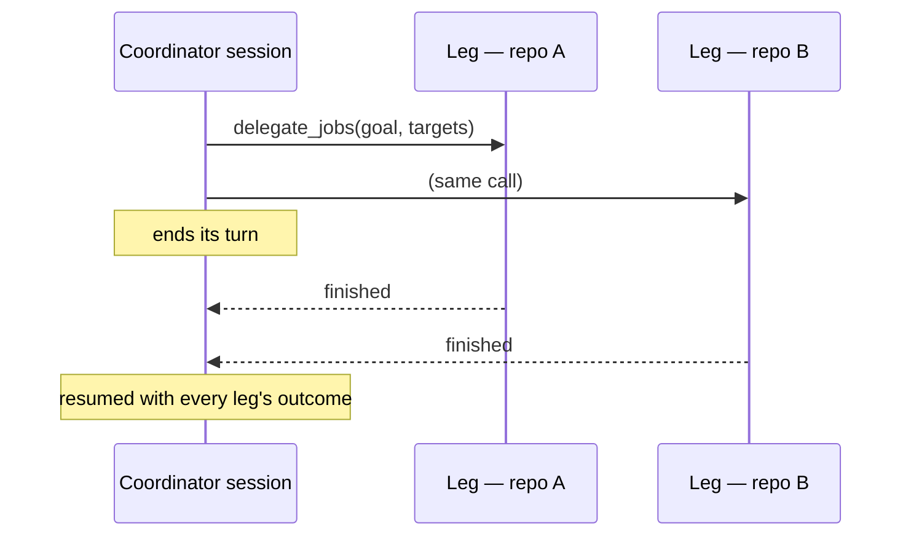

# Orchestration

Orchestration lets the agent on one repository — a **coordination repository** — turn a single request into tailored jobs on your other repositories, and report the combined outcome once they have all finished.

Use it to:

- **Coordinate multi-repository changes** — bump a shared library in every service that depends on it.
- **Route tickets** — read an issue queue and dispatch each ticket to the repository that owns it.
- **Investigate in parallel** — check every service for a security advisory and collect the answers.

## How it works

When orchestration is on, the agent gets a `delegate_jobs` tool. It takes a one-line `goal` and up to 10 targets, each a repository, an optional branch and a **prompt written for that repository**. DAIV starts one independent job per target (a *leg*), and the coordinator ends its turn.

Each leg is an ordinary agent job on its own repository: it uses that repository's `.daiv.yml`, skills and sandbox environment, and opens its own merge request when it changes code. When the last leg finishes, DAIV queues a new run on the coordinator's session — a *Delegation Resume* run — whose prompt lists every leg's outcome, merge request and reply. The coordinator picks up from there: it checks the results, reports them where the request came from (a comment on the ticket, for example), or delegates another batch. The resumed run can stop to ask a question like any other job.



Nothing polls while the legs run: the coordinator holds no worker and spends no tokens until it is resumed.

## Turning it on

Orchestration is **off by default**. Turn it on in the coordination repository's `.daiv.yml`:

```yaml
orchestration:
  enabled: true
```

A repository needs no configuration to *receive* delegated work; a leg is a normal job.

## Writing the prompts

A leg sees only its own prompt — not the coordinator's conversation, the ticket, or anything the coordinator looked up. Each target's prompt must therefore carry everything that leg needs, and should end with the no-change convention: *"If this repository is unaffected, reply saying so and make no changes."*

```json
{
  "goal": "Apply the CVE-2026-12345 patch",
  "targets": [
    { "repo_id": "mygroup/service-auth", "prompt": "Bump the auth library to 3.2.1 (CVE-2026-12345). If this repository is unaffected, reply saying so and make no changes." },
    { "repo_id": "mygroup/service-api", "ref": "release/2.x", "prompt": "Update the auth dependency to 3.2.1 and fix any breaking import. If this repository is unaffected, reply saying so and make no changes." }
  ]
}
```

The `goal` only titles the batch; it is never sent to a leg.

## Rules and limits

| Rule | Why |
|------|-----|
| At most **10 targets** per call | Split larger fan-outs across calls. |
| **One level deep** | A leg gets no `delegate_jobs` tool, even on a repository with orchestration on, so a leg's run is its whole answer. |
| Not the coordinator's own checkout | Parallel work inside one repository belongs to [subagents](subagents.md). A different branch of the same repository is allowed. |
| Each checkout once per call | A blank `ref` and the default branch's name are the same checkout; combine their work into one prompt. |
| Legs run as the user who triggered the coordinator's run | Targets that user cannot write to come back as failures; the rest still start. A run with no DAIV user behind it (e.g. a mention from an account not linked to DAIV) cannot delegate. The resumed run runs as the same user, and fails instead of starting if that user can no longer write to the coordination repository. |
| Legs cannot ask questions | Nobody is watching a leg, so it decides or reports instead of stopping for input. |

If no target starts, the tool says so and no resume comes: the coordinator deals with the failures in the same turn. If the resumed run cannot be queued when the last leg finishes, DAIV retries it within a few minutes.

## Ticket-triage recipe

A coordination repository can hold no production code at all and act as a routing hub:

1. **Attach your ticketing system** as an [MCP server](../customization/mcp-tools.md) (Jira, Linear, Request Tracker, …), so the coordinator can read tickets and comment on them.
2. **Write the routing rules in its `AGENTS.md`**:

    ```markdown
    # Routing rules

    - Tickets tagged `backend` → mygroup/service-api
    - Tickets tagged `frontend` → mygroup/service-web
    - Unclassified tickets → skip, comment "needs triage label"
    ```

3. **Trigger it** with a [Scheduled Job](scheduled-jobs.md) that polls the queue, or from your ticketing system through the [Jobs API](jobs-api.md):

    ```
    Fetch the open tickets not yet dispatched. Route each one with the rules in AGENTS.md and delegate one
    target per repository, combining tickets that route to the same repository into its prompt. When the
    legs finish, comment the merge request links on each ticket.
    ```

## Seeing the batch

Every leg is its own session in the [Sessions](sessions.md) list, and the legs of one call share a batch. The coordinator's session shows the delegation and, later, the resumed run with the legs' summary. [Notifications](notifications.md) treat the legs as a batch, so you get one rollup when they need a look.

!!! note "Why not call DAIV's own MCP endpoint?"
    [`submit_job`](mcp-endpoint.md) starts the same kind of jobs, but a caller can only poll or block for the result. That suits an editor or a script; inside an agent run it would hold a worker while the legs wait for one, with no way to resume afterwards. `delegate_jobs` ends the coordinator's turn and resumes it when the work is done.

## See also

- [Repository Config](../customization/repository-config.md) — the `orchestration` toggle
- [Jobs API](jobs-api.md) and [MCP Endpoint](mcp-endpoint.md) — a batch can also give each repository its own `prompt`
- [Subagents](subagents.md) — parallel work inside one repository
