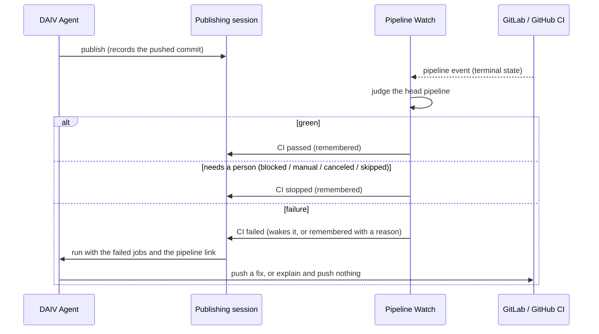

# Pipeline watch

After DAIV publishes a merge request, it watches the merge request's CI and tells the session that published it what happened. A CI failure on a commit DAIV pushed wakes that session, up to a configurable number of times, to look at the failure and fix it; if the failure is not something a code change can fix, the run explains why instead of pushing. Everything else CI reports, a pass or a pipeline that needs a person, is remembered by the session and shown to the agent the next time it runs.

## Turn on CI events

Pipeline watch reacts to CI events, and each platform delivers them differently. Without these events, DAIV hears of CI only through the reconciler's poll, which re-reads a watched merge request that nothing was heard of for 30 minutes, so a failure can wait 30 minutes or more. On GitHub, DAIV also cannot read CI at all until the App's **Actions** permission is **Read-only**.

### GitLab

DAIV registers `pipeline_events` on a repository's webhook when it creates the webhook. To add the event to webhooks DAIV registered earlier, run this on the host that runs DAIV:

```bash
docker compose exec app django-admin setup_webhooks --update
```

[`setup_webhooks`](../reference/management-commands.md#setup_webhooks) describes the command.

### GitHub

`setup_webhooks` does nothing on GitHub, because a GitHub App's event subscriptions are central, not per repository. Subscribing the App covers every repository it is installed on:

1. Open your GitHub App's settings page and select **Permissions & events**.
2. Under **Repository permissions**, set **Actions** to **Read-only**. This permission lets the App subscribe to **Workflow run** and read job logs.
3. Under **Subscribe to events**, select **Workflow run**.
4. Select **Save changes**.
5. If **Actions** is a new permission for the App, ask each installation owner to accept it, from GitHub's email or the installation's **Configure** page. Pipeline watch stays off on an installation until its owner accepts.
6. After the next workflow run, open **Advanced** → **Recent Deliveries** and check for a `workflow_run` delivery.

[Platform setup](../getting-started/platform-setup.md#github-app-permissions-and-events) lists every event the App needs.

---

## How it works



The steps below give the same flow in text.

1. **The publishing session owns the merge request.** When a run publishes, its session claims the merge request and records the commit DAIV pushed. A later publish from another session of the same person moves the merge request to that session; a publish from another person's session leaves it where it is and tells the owning session. [Which runs claim a merge request](#which-runs-claim-a-merge-request) lists the cases.
2. **Pipeline event.** A webhook from GitLab (`pipeline_events`) or GitHub (`workflow_run`) delivers the terminal result. CI is also judged right after a publish, because the event can arrive before the claim exists. Only the merge request's head pipeline is judged; a pipeline an older push started is ignored.
3. **Judgment.** See [Conservative judgment](#conservative-judgment) below.
4. **Waking the session.** A failure wakes the owning session only when all of these hold. The first one that does not is recorded as the reason the failure was only remembered, and the agent sees it the next time it runs.

    | Condition | Reason when it fails |
    |---|---|
    | The watch is on for the repository and for this merge request | Watch off |
    | The pipeline ran on the commit DAIV last pushed | Not DAIV's commit |
    | No CI run looked at that commit yet, and its [`before_publish` checks](../customization/repository-config.md#verification-hooks) did not still fail | Already examined |
    | Attempts are left | Attempts spent |
    | DAIV has not started three runs in a row on the session without a person (see [The session inbox](sessions.md#the-session-inbox)) | Too many runs in a row |

5. **The CI run.** DAIV runs it in the publishing session, on the merge request's branch, with a prompt naming the failed jobs and the pipeline URL. The agent reads the job logs through its `gitlab` / `gh` platform tool, then pushes a fix or explains why it pushed nothing. It can't ask a question: nobody is there to answer. If the session is busy, the failure waits and joins the session's next run.
6. **A run that pushes nothing** explains, without giving up. No push means no new pipeline, so the session shows CI as failing with a link to that run's explanation, and you receive its summary as a run notification. Retrying the same pipeline by hand does not wake the session again: the commit was already examined. If the retry passes, the session shows CI passing.
7. **Attempts spent.** When a failure on a new DAIV commit finds no attempts left, the merge request's owner is notified once for that commit. A run a person starts that publishes to the merge request gives the attempts back.
8. **Reconciler.** A cron task runs every 10 minutes and re-reads the CI of each watched merge request nothing was heard of for 30 minutes, whatever it last reported, so a missed webhook (a manual retry's, say) is repaired. On GitLab it reads the branch's latest pipeline; on GitHub, the latest run of each workflow on the branch's head commit. A pipeline already judged in its status is skipped without reading its jobs. Nothing expires: the watch observes until the merge request is merged or closed. Each tick re-reads at most 200 branches, the longest-quiet first, and a branch it could not read is tried again on the next tick.

---

## Conservative judgment

DAIV errs toward remembering rather than spending an attempt on something it cannot fix. The decision table:

Rows are evaluated top to bottom; the first match wins.

| Pipeline state | Jobs | Outcome |
|---|---|---|
| still in progress (`created`, `pending`, `running`, `preparing`, …), or no pipeline found | any | **Not judged** — nothing posted; the next event or the reconciler looks again |
| `skipped` | zero jobs | **Not judged** — a `ci.skip` push records this in place of a pipeline |
| `blocked`, `manual`, `canceled`, `skipped` | any | **Stopped** — remembered, shown as needing a person |
| any | zero jobs | **Stopped** — remembered, shown as needing a person |
| `failed` | at least one non-`allow_failure` failed job | **Failed** — may wake the session |
| `failed` | no job reports `failed` at all (e.g. a config error) | **Failed** — may wake the session |
| `failed` | every failed job is `allow_failure` | **Passed** — effectively a pass |
| `success` | at least one job | **Passed** |

**Why zero-job pipelines are stopped, not passed:** a GitLab `.gitlab-ci.yml` that includes a cross-project template from a private repository resolves as the pushing identity. An ephemeral project-scoped token cannot read that private repository, so GitLab produces a pipeline with no jobs. Treating it as green would let a misconfigured pipeline pass silently; treating it as a failure would burn every attempt on a pipeline that was never going to run.

**Why blocked/manual/skipped/canceled are stopped:** these states reflect a human decision or an external gate. DAIV does not know whether to wait or act, so it remembers the result and lets you decide.

---

## CI status on the session page

The sidebar's repository cards show CI for each open merge request the session owns. A card shows **Waiting for CI** while no result has arrived since DAIV last pushed or while a run is looking at a failure. It then shows **Passing**, **Failing** or **Needs a person**. A failing merge request links the last run that looked at a failure, whose summary says what it found.

## Turn the watch on or off for a merge request

The **Fix CI failures** switch turns the watch on or off for one merge request. With it off, DAIV still remembers CI results but never wakes the session. Turning it on gives the merge request its attempts back and judges the branch's latest pipelines again at once (on GitHub, every workflow's), so a failure reported while the watch was off, or while no attempts were left, wakes the session. A commit a run already looked at is not looked at again. You need to be able to run agents on the repository.

1. Open the session that owns the merge request.
2. In the repository card, open the **⋯** menu.
3. Select **Fix CI failures**. A check mark shows the watch is on.

---

## Notifications

Every CI run produces the usual run notification, with the run's summary, so you hear what it found whether it pushed a fix or explained why it didn't. When attempts run out on a new DAIV commit, the merge request's owner gets one **CI still failing** notification for that commit, linking the owning session. A merge request whose owning session has no DAIV user behind it gets that outcome, and each CI run's summary, as a merge request comment instead.

---

## Limit or turn off pipeline watch

An administrator sets the site-wide switch and attempt cap under **Configuration** → **Pipeline Watch**, or with `DAIV_PIPELINE_WATCH_ENABLED` and `DAIV_PIPELINE_WATCH_MAX_ATTEMPTS`. With the switch off, no CI failure wakes a session, and sessions remember each failure with the reason *Watch off*. By default a merge request gets 3 fix attempts. [Site configuration](../reference/site-configuration.md) and the [environment variables reference](../reference/env-variables.md) describe both settings.

A repository can only tighten the site-wide values. Set its options in `.daiv.yml`:

```yaml
pipeline_watch:
  enabled: true
  max_attempts: 2
```

`enabled: false` stops CI failures on the repository from waking a session. `max_attempts` is capped at the site-wide value, and `enabled: true` does not turn the watch on where the site turned it off. [Repository configuration](../customization/repository-config.md#feature-toggles) lists both options.

---

## Platform notes

### GitHub: `allow_failure` jobs

The GitHub Actions API does not say which jobs are required, so DAIV treats every failed job as required. The verdict itself still comes from the workflow run's own conclusion, so a tolerated job's failure cannot by itself spend an attempt — a run that concludes `success` is green. What differs from GitLab is narrower: DAIV cannot exclude a tolerated job from the failure list it hands the agent, and it never reads a failed run as green on the grounds that every failure was tolerated.

### GitHub: one event per workflow, not per push

A `workflow_run` event reports a single workflow, not the branch's whole CI. A repository with several workflows on one push delivers one event per workflow, each judged on its own — so the first workflow to finish green can show CI as passing while another is still running or about to fail. Repositories that split required checks across workflows should expect the status to flip as each workflow reports. A session that delegated the work is told its CI passed only once the latest run of every workflow on the commit has passed.

### GitLab: child pipelines

A child pipeline (`trigger: include:`) runs on its parent's branch and commit, so DAIV ignores it and judges the parent pipeline, which is the merge request's result. For a child's failure to count, trigger it with `strategy: depend`, so the parent pipeline fails with it.

### GitLab: merge-request pipelines and the reconciler poll

The reconciler's fallback poll lists pipelines by branch (`ref=<source branch>`). Detached merge-request pipelines are not on the branch ref — GitLab records them under `refs/merge-requests/<iid>/head` — so on projects that run *only* merge-request pipelines the poll finds nothing. This is harmless: a read that finds no pipeline posts nothing, so those repositories are driven entirely by the pipeline webhook.

---

## Which runs claim a merge request

| How the merge request was published | Session that owns it |
|---|---|
| Issue addressing (`daiv`, `daiv-auto` or `daiv-max` label, or a mention on an issue) | The issue's session |
| Job runs — REST API, MCP `submit_job`, scheduled jobs | The job's session |
| Chat turn | The chat session |
| A CI run in the owning session | Stays with that session, keeping the attempts spent |
| Review addressing (DAIV answering comments on a merge request no session owns) | **None** |

Review addressing is excluded deliberately. It pushes to a merge request someone else may own, so babysitting that pipeline would put commits nobody asked for on their branch. Reviewers who want CI fixed can ask for it in a comment.

---

## What pipeline watch does not do

- **Watches only merge requests DAIV published.** There is no opt-in label to watch an existing merge request.
- **Does not distinguish flaky from real failures.** Every failure on DAIV's commit may wake the session; the attempt cap bounds the cost, and a run that finds nothing to fix says so.
- **Does not react to CI on the default branch.** The watch is scoped to the merge request's branch.

---

## Related pages

- [Issue addressing](issue-addressing.md) — the workflow that produces most DAIV-published merge requests
- [Pull request assistant](pull-request-assistant.md) — mention DAIV in a comment to request a manual pipeline fix
- [Sessions](sessions.md) — CI runs appear in the session that published the merge request
- [Notifications](notifications.md) — how run and give-up notifications are delivered
- [Repository configuration](../customization/repository-config.md) — the full `.daiv.yml` reference
