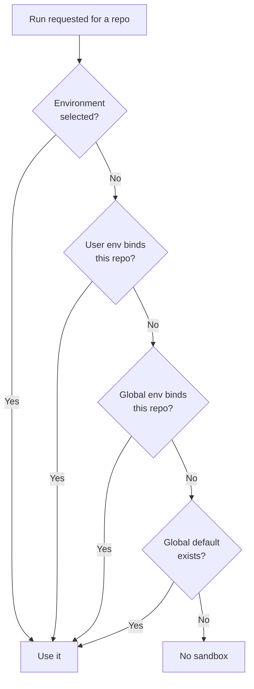

# Sandbox environments

A sandbox environment is a named, reusable [sandbox](sandbox.md) runtime: a base image, CPU and memory limits, an egress policy, encrypted environment variables, and the repositories it applies to. You define it once, and DAIV reuses it for every run, chat, scheduled job, and API or MCP call that lands in a matching repository.

An environment is how you give the agent a toolchain image, outbound network access to install dependencies, or a secret such as an API token or a private registry credential. Without a global default environment and without one selected for the run, a run has no sandbox and the agent gets no `bash` tool.

To manage environments, open **Sandbox environments** under **Agent setup** in the sidebar (`/dashboard/sandbox-envs/`). **Global environments** lists the shared environments, and **My environments** lists yours.

## Scopes

An environment has one of two scopes:

| Scope | Who sees it | Who manages it |
|-------|-------------|----------------|
| **User** | Only you | You |
| **Global** | Everyone | Administrators |

Any signed-in user creates, changes and deletes their own User environments. Only administrators create, change and delete Global environments, and only they can make one the default. Other users see Global environments in the list and can select them for a run. In the form, the **Scope** choice offers only **Personal** to other users, and offers **Shared with everyone** (a Global environment) to administrators as well.

When DAIV picks an environment for a repository, a User environment that claims the repository wins over a Global one, so you can override an organization-wide setup for the repositories you care about.

### Global default

One Global environment can be the default. DAIV falls back to it when no other environment matches a repository, and it supplies the CPUs, memory and environment variables that other environments leave unset (see [How an environment is resolved](#how-an-environment-is-resolved)). With no global default, a run that matches no environment has no sandbox.

To make an environment the global default, as an administrator:

1. In **Global environments**, find the environment.
2. Select **Make default**. The environment gets a **default** tag, and the previous default loses it.

You cannot delete the global default: DAIV shows `Set another global environment as default before deleting this one.` Make another environment the default first.

## Create an environment

You need a base image for the environment, such as `python:3.14`. To let the agent install dependencies, you also need to know which hosts it must reach.

1. In the sidebar, under **Agent setup**, open **Sandbox environments**.
2. Select **New environment**. The **New sandbox environment** drawer opens.
3. Fill in the fields in the table below, starting with **Name** and **Base image**.
4. Select **Save**. The drawer closes, and the environment appears in its list.

| Field | What to enter |
|-------|---------------|
| **Name** | A label of up to 80 characters, unique within its scope. Required. |
| **Description** | Free text. Optional. |
| **Scope** | **Personal** for a User environment, or **Shared with everyone** for a Global one. Only administrators see the second choice. |
| **Base image** | The image the sandbox runs, for example `python:3.14`, `node:22` or `ubuntu:24.04`. Required. |
| **Environment variables** | Name and value pairs for the sandbox, each plain or secret. See [Environment variables](#environment-variables). |
| **Repositories** | The repositories the environment claims, as `owner/repo` or `group/subgroup/repo`. See [Repository bindings](#repository-bindings). |
| **Network** | **Off** (the default) or **On**. **On** shows the **Network access** section. See [Network access and egress policy](#network-access-and-egress-policy). |
| **Resources** | Expand it to set **Memory** and **CPUs**. Each is **Use default** or **Custom**. |
| **Memory** | A whole number of at least 1, with the unit **MiB** or **GiB**. |
| **CPUs** | A number of at least 0.25, in steps of 0.25. |

**Use default** leaves **Memory** or **CPUs** unset, so the value comes from the global default environment. If that sets none either, DAIV asks for no limit. On the global default itself, the option reads **Unconstrained**. **Network** never comes from the global default: each environment sets its own.

## Change an environment

!!! warning "Changing an environment replaces the sandbox"
    A change to the base image, memory, CPUs, environment variables or egress policy replaces the sandbox of every existing session that uses the environment, on that session's next turn. The new sandbox starts from the repository, so anything installed in the old one, and anything a stopped turn left uncommitted, is lost.

To change an environment:

1. In **Sandbox environments**, select **Edit** next to the environment.
2. Change the fields, as in [Create an environment](#create-an-environment).
3. Select **Save**.

DAIV replaces a session's sandbox when the environment the turn resolves to differs from the one the sandbox started from. The comparison uses the environment merged over the global default, so switching the session to another environment, or changing the global default, replaces the sandbox too. DAIV updates a new git token on the running sandbox instead of replacing it.

## Delete an environment

1. In **Sandbox environments**, select **Delete** next to the environment.
2. Select **Delete** to confirm `Delete environment "<name>"?`.

## Environment variables

Each variable has a name and a value. A name is a shell identifier: letters, digits and underscores, not starting with a digit. An environment has at most 100 variables, and the encrypted values together may not exceed 32 KiB.

- Select **Add variable** to add a row, or **Paste .env** to import lines such as `KEY=value`. DAIV skips comments and blank lines, and you choose whether to merge (names that already exist are kept) or to replace all current variables.
- Set a row's toggle to **Secret** to hide its value. DAIV never shows a stored secret again: the dashboard shows the placeholder `🔒 keep existing`, and API and MCP responses show `******`. When you save, a secret keeps its stored value unless you type a new one.

DAIV encrypts the values with Fernet before it stores them and decrypts them when a run needs them, using `DAIV_ENCRYPTION_KEY` (see [Environment variables](../reference/env-variables.md#external-url-and-encryption-key)). If the key changes and DAIV can no longer decrypt the stored values, the form refuses to save until you re-enter every secret value. Agent runs continue without the unreadable variables.

## Network access and egress policy

An environment with **Network** set to **Off** has no outbound network access. With **Network** set to **On**, the sandbox reaches only the hosts the **Network access** section allows, through the egress proxy of daiv-sandbox. The proxy can add a credential to a request, so a credential never enters the sandbox.

The egress proxy needs a CA certificate and key on the sandbox service (see [Deployment files](../reference/env-variables.md#deployment-files)). Without them, a run that uses an environment with **Network** **On** stops instead of running with unrestricted network access.

DAIV runs git, including the push that publishes a run, from inside the sandbox. So DAIV always allows the run's git platform (GitLab or GitHub) and authenticates it with a token it mints for the run, even when **Network** is **Off**. You never list it. Otherwise a **Network** **Off** environment stays isolated, and the git platform is opened only when the run holds a push token, so evaluation runs without one stay fully isolated.

### Allowed hosts

**Allowed hosts** lists one rule per host:

| Control | Meaning |
|---------|---------|
| Host field | A host name or a glob such as `pypi.org` or `*.github.com`. |
| **All methods** or **Read-only** | The HTTP methods the rule covers. **Read-only** covers `GET`, `HEAD` and `OPTIONS`. |
| **+ credential** | An HTTP header name, such as `Authorization`, and a value. The proxy adds the header to every request to the host. |

**Unlisted hosts** sets what happens to a request that matches no rule:

- **Deny** blocks it.
- **Allow** lets it through.

With **Network** **On**, the policy must permit something. DAIV rejects a policy that has no allowed host and sets **Unlisted hosts** to **Deny**, with `Network is On but the egress policy permits nothing. Add at least one allowed host, set the default to allow, or switch Network to Off.` To block all general outbound traffic, set **Network** to **Off**. DAIV then stores no egress policy.

The proxy always inspects the TLS traffic of every reachable host, which is what lets it add credentials and enforce the method rules. You cannot turn that off.

DAIV encrypts credential values with Fernet before it stores them, and never sends them back to the browser or in an API or MCP response. A saved credential shows the placeholder `🔒 keep existing`, and saving keeps it unless you type a new value. An environment has at most 100 allowed-host rules and 100 credentials, and the encrypted credentials together may not exceed 32 KiB. A credential header name must be a valid HTTP header name, and its value cannot contain a line break.

If DAIV cannot decrypt an environment's egress credentials at run time, or its egress configuration is invalid, the run starts with no network access.

## Repository bindings

The **Repositories** field lists the repositories the environment claims. To add one, type `owner/repo` or `group/subgroup/repo` and select **Add**. When a run targets a claimed repository and no environment is selected, DAIV picks this one (see [How an environment is resolved](#how-an-environment-is-resolved)).

A repository can be claimed by one environment per scope. For User environments, that means one of your own. DAIV rejects a binding that overlaps another environment of the same scope and names that environment. The same repository can still appear in one User environment and one Global environment, and the User one wins.

## How an environment is resolved

When a run is requested, DAIV picks its environment for each repository in this order, records the choice on the run, and a session keeps the environment of its first run:

1. **Selected environment.** An environment chosen for the run overrides everything below. See [Choose an environment for a run](#choose-an-environment-for-a-run).
2. **User binding.** Your User environment that claims the repository.
3. **Global binding.** A Global environment that is not the default and that claims the repository.
4. **Global default.** The Global environment marked as default.
5. **None.** The run has no sandbox, and the agent gets no `bash` tool.

Runs that a webhook starts, such as [issue addressing](issue-addressing.md), belong to no DAIV user, so step 2 does not apply to them. They start at step 3.

DAIV then merges the chosen environment over the global default to get the effective runtime. The chosen environment wins for the base image, memory and CPUs when it sets a value, and the global default fills the rest. The environment variables of both are combined, and the chosen environment's variables replace same-named ones of the default. The egress policy is the exception: it comes from the chosen environment alone, so an environment with **Network** **Off** never inherits the default's policy.

The run starts from the recorded choice, so changing a binding afterwards moves no existing run. A run that a session's inbox starts, such as a [pipeline watch](pipeline-watch.md) CI fix, uses the environment recorded on the session. For a run on behalf of someone else, such as a reply to another person's mention, DAIV never uses the session owner's User environment. It resolves one for that person instead: their own, a repository binding, or the global default. A session with no recorded environment, because its publishing run had none or its environment was deleted, runs on the global default.

## Choose an environment for a run

You do not have to bind an environment to a repository, because you can select one for a run. A selected environment always wins. Each surface has its own control, described on its page:

- The run composer and the chat workspace, in [Sessions](sessions.md): the **Sandbox environment** picker, which stays on **Auto** until you choose.
- A schedule, in [Scheduled jobs](scheduled-jobs.md): pin every run of the schedule to one environment.
- The `environment` field of `POST /api/jobs`, in the [Jobs API](jobs-api.md).
- The `environment` argument of the `submit_job` tool, in the [MCP endpoint](mcp-endpoint.md), which also has the `list_environments` and `get_environment` tools to look environments up.

**Auto** means DAIV resolves the environment as above.

## Related pages

-   :octicons-container-24: **Sandbox**

    ---

    What the agent runs inside the sandbox, and the command policy that governs it.

    [:octicons-arrow-right-24: Sandbox](sandbox.md)

-   :octicons-clock-24: **Scheduled jobs**

    ---

    Pin a sandbox environment to a recurring agent run.

    [:octicons-arrow-right-24: Scheduled jobs](scheduled-jobs.md)

-   :octicons-terminal-24: **Jobs API**

    ---

    Submit jobs over HTTP with an `environment` parameter.

    [:octicons-arrow-right-24: Jobs API](jobs-api.md)

-   :octicons-plug-24: **MCP endpoint**

    ---

    Pick environments from Claude Code, Cursor, and other MCP clients.

    [:octicons-arrow-right-24: MCP endpoint](mcp-endpoint.md)

