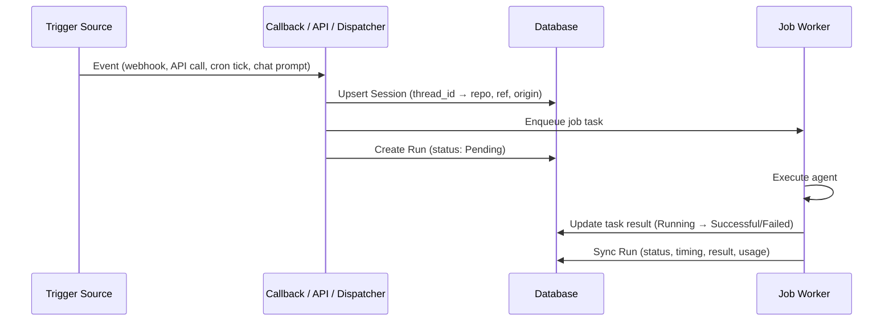

# Sessions

DAIV records every agent execution in a **Session**. A session is one agent thread — a persistent conversation context tied to a repository and ref. Every way you can trigger DAIV (webhooks, the Jobs API, the MCP endpoint, scheduled jobs, or a chat conversation you type yourself) produces a session, and every time the agent runs against that thread produces a **Run** inside it.

Navigate to **Dashboard > Sessions** (`/dashboard/sessions/`) to see the unified list. Clicking any session opens its detail page — the transcript, run timeline, and timing and usage for every execution.

!!! info "What you can see"
    Admins see all sessions across every repository. Regular users see their own sessions, sessions matched to their git platform username (from webhook payloads), and sessions from [Scheduled Jobs](scheduled-jobs.md) they subscribe to. The same scoping applies to the detail page, live updates, and retries.

---

## Sessions and Runs

A **Session** groups all runs that share the same agent thread:

- **Session** — the thread. Has a repository, ref, origin (how it was first triggered), title, and an optional link to an issue or merge request, schedule, or user.
- **Run** — one agent execution inside that session. A session can have many runs: retries, follow-up chat turns, and API submissions that continue the thread all add new runs to the same session.

A chat conversation is a session where the origin is `Chat`; each turn you send creates a new Run. A webhook event (issue or MR) creates a session tied to the issue or merge request; the single agent invocation is its first Run.

---

## Origin types

Each session is tagged with the origin that created it:

| Origin | Source | Example |
|--------|--------|---------|
| **Chat** | Dashboard session workspace | You type a prompt and stream a reply |
| **API Run** | [Jobs API](jobs-api.md) `POST /api/jobs` | A CI pipeline or script submits a prompt |
| **MCP Run** | [MCP Endpoint](mcp-endpoint.md) `submit_job` tool | Claude Code or Cursor delegates a task |
| **Scheduled Run** | [Scheduled Jobs](scheduled-jobs.md) cron dispatch | A weekly dependency audit fires on Monday |
| **UI Run** | Dashboard run composer (see below) | You start a run from **Dashboard > Sessions** |
| **Issue Webhook** | GitLab/GitHub issue event | An issue is labelled `daiv` |
| **MR/PR Webhook** | GitLab/GitHub merge request event | A reviewer mentions `@daiv` on a merge request |
| **Delegated Run** | A coordinator's `delegate_jobs` call ([Orchestration](orchestration.md)) | One repository's part of a multi-repository change |

---

## Home

The Home page (`/dashboard/`) opens with **Needs you**: what is waiting on you, up to eight items. Questions come first, then failures (Failed, CI still failing, Can't run), then Found issues, then Needs attention; newest first within each.

- **Needs input** — your session's latest run asked you a question. It leaves when you answer.
- **Failed** — your session's latest run failed. It leaves once a newer run starts in the session (**Retry** starts one), once you run the same prompt on the same repository again, or 14 days after it failed; it stays in Sessions. A run you cancelled doesn't count.
- **CI still failing** — DAIV's CI watch on a merge/pull request gave up. Shown for 7 days.
- **Can't run** — one of your schedules can't start its runs. It leaves when the schedule starts a run again or you pause it.
- **Found issues** / **Needs attention** — your session's latest run was classified that way. Shown for 7 days, since a fix made outside DAIV leaves no trace it can see.

A session counts once, as the first of these it matches: a question in a session whose CI watch gave up shows as Needs input. A session with no activity for 90 days leaves the list.

Below it are your five most recent sessions, the ways to start work (issue labels, mentions and slash commands on your Git platform; this instance's MCP URL for your editor; Chat and Background run here), and **Your week**: what the runs in your own sessions came to over the last 7 days, a column a day stacked by outcome (changed code, done without changes, needed you, failed), the merge requests its runs worked on, and where you started work from. A day's column opens your sessions that ran that day. Team statistics are on Insights.

## Insights

**Insights** (`/dashboard/insights/`) shows how DAIV is used across the repositories you can see, over Today, 7 days (the default), 30 days, 90 days or all time.

- **Agent activity** — runs, success rate, runs that changed code and average duration, each compared with the period of the same length just before, up to the same time of day (the page names both). Running now is live and not compared.
- **Runs over time** — a column per day (weeks for 30 and 90 days, months for all time), stacked by outcome: changed code, done without changes, needs input, failed. A column opens the sessions active in its days. Hidden for Today.
- **Sessions by origin** — each origin's sessions this period and the period before, the change, and a small bar per day. Every count for this period opens the session list it counts; the period before and the bars count sessions with a run in those days, so later activity doesn't move them.
- **Code velocity** — see [Merge Metrics](merge-metrics.md).

## Sessions list

The sessions list shows all sessions in reverse chronological order. Each row displays:

- **Status indicator** — colour-coded dot (queued, pending, running, successful, failed) reflecting the latest run's state
- **Title** — the session title (generated automatically from the first prompt or issue/MR subject)
- **Repository** — which repository the agent operates on
- **Origin badge** — the session's origin (see above)
- **Timing and usage** — when the session was last active, and the total tokens and cost across all its runs

!!! note "Queued runs"
    An API or MCP job that continues a busy session doesn't start immediately: it joins the session's next run for its branch, shown as **Queued**, which starts once the current run finishes (see [The session inbox](#the-session-inbox)).

### Filtering

Use the filter controls at the top of the list to narrow results:

| Filter | Description |
|--------|-------------|
| **Status** | Queued, Pending, Running, Successful, or Failed |
| **Origin type** | Chat, API Run, MCP Run, Scheduled Run, UI Run, Issue Webhook, MR/PR Webhook, or Delegated Run |
| **Repository** | Search and select a specific repository |
| **Date range** | From / To date pickers |
| **Schedule** | Pre-applied when navigating from a scheduled job's run count |
| **Batch** | Pre-applied when viewing a multi-repo submission group (one prompt submitted across several repositories shares a batch ID) |
| **Merge request** | Pre-applied when arriving from the **view sessions** link in a merge request description. Always paired with a repository, since IIDs are per-project; clearing the repository clears it too |

Filters are combined with AND logic and reflected in the URL query string, so filtered views can be bookmarked or shared.

### Live updates

Sessions with in-flight runs (Queued, Pending, or Running) update automatically via server-sent events. The status dot and timing update in real time without a page refresh.

---

## Session detail

Click any session to see its full detail page, which includes:

- **Origin and status badges**
- **Context** — repository, branch/ref, linked schedule or issue/MR (as a clickable link) or, for a delegated run, the session that delegated it, the agent model and thinking level, and the sandbox environment. Admins viewing another user's session also see the owning user.
- **Delegated jobs** — on a session that delegated work, each job's current state, in the transcript, the top bar and the details panel (see [Orchestration](orchestration.md#seeing-the-batch)).
- **Transcript** — the full conversation transcript streams live during active runs, whatever started them (chat, job, webhook or schedule), and is replayed on return visits and mid-run refreshes — reopening the session rejoins the live stream and replays any events it missed (a fresh page load from the start of the run; an automatic reconnect only the events since it dropped).

For in-flight sessions the detail page updates in real time until the run completes.

---

## Artifacts

A run's final message is a paragraph of text, and the agent's workspace is thrown away when the run ends. Tasks whose deliverable is a *document* — a dependency audit, a code-quality report, a changelog draft, a chart — need somewhere else to put it. That is what **artifacts** are for.

The agent has a `publish_artifact` tool: it writes the file to its scratchpad (`/workspace/tmp/...`), publishes it, and gets back a URL that it includes in its final response. DAIV copies the file out of the sandbox into its own storage and attaches it to the run, so it stays available after the sandbox is gone and without committing anything to the repository.

Published files appear inline in the transcript, as part of the turn that published them: adjacent `publish_artifact` calls in one turn group into a single **Artifacts** card, one row per file. Each row shows the title (linking to the viewer page, `/dashboard/sessions/<thread_id>/artifacts/<id>/`, opened in a new tab), a kind pill, the file size, and a download icon. A publish still in progress shows "Publishing…"; a publish that failed shows its path with a red × and the error message in red — in the same card as any files that did publish. Reloading the page renders the same rows, though publishes from consecutive model steps can land in separate cards. If a session has no archived transcript (its checkpoint expired before DAIV archived sessions), its artifacts still show on the session page, one card per run, below the expired notice.

What the viewer shows depends on the file type:

| File type | Viewer |
|-----------|--------|
| Markdown (`.md`) | Rendered server-side, sanitized, in the DAIV shell; **Copy source** copies the raw Markdown |
| HTML (`.html`) | Rendered inside a **sandboxed frame** — inline CSS and scripts run, but in an opaque origin with no access to DAIV cookies, storage or pages. Fetch/XHR and form posts are blocked; scripts, styles, images and fonts may still load over HTTPS. **Full screen** expands the frame |
| Images (`.png`, `.svg`, `.jpg`, `.gif`, `.webp`) | Displayed inline on a checkerboard, so transparency shows; click to open at full size |
| Text, CSV, JSON, XML, YAML, logs | Shown as preformatted text; **Copy source** copies it |
| Anything else (`.pdf`, archives, …) | Download only |

Markdown and text files over 1 MiB are not previewed; the viewer offers the download instead.

The viewer's header shows the artifact's kind, its repository, and a link back to the session run that produced it. **Open raw** serves the file as-is under the same sandbox policy, so opening an HTML report in its own tab is as safe as the embedded frame. Whoever can open the session can open its artifacts.

Navigate to **Dashboard > Artifacts** (`/dashboard/artifacts/`) for every artifact you can see across all sessions — your own sessions, plus sessions on repositories you can read (admins see every artifact) — newest first, grouped by date (Today, Yesterday, Previous 7 days, Previous 30 days, then by month), 25 per page. Search by title or filename, and filter by kind (All, Markdown, HTML, Image, Text, or File) and repository. Each row links to the viewer, back to the session and run that produced it, and to a download. The viewer's breadcrumb links back to this list.

Artifacts are also listed in the [Jobs API](jobs-api.md#poll-job-status) and [MCP](mcp-endpoint.md) job-status responses, with absolute viewer and download URLs, so a CI pipeline or an editor assistant can hand the report to a person.

!!! note "Limits and storage"
    A file is capped at `DAIV_ARTIFACT_MAX_BYTES` (default 10 MiB) and a run at `DAIV_ARTIFACTS_PER_RUN_MAX` files (default 20). Files live in Django's default file storage under `MEDIA_ROOT` (`/home/daiv/data/media` in the containers), which the `app` and `worker` containers must share through one volume — see the [deployment guide](../getting-started/deployment.md). Deleting a run deletes its artifacts and their files.

### Revising an artifact

Ask the agent to change a report it already published — "add a section on licenses", "make the table sortable" — and it revises the artifact instead of publishing a new one: it edits the file and publishes it again with the artifact's id, so the file is replaced and **the URL stays the same**. If the file is no longer in its workspace (an earlier run published it), the agent first copies it back with `fetch_artifact`. This works across runs of the same session, but never across sessions: the agent can only read or revise artifacts of the session it runs in. You can paste an artifact's URL into the conversation to point the agent at it.

A revised artifact stays on the run that first published it — on the dashboard, and in the per-run artifact cards of a session with no transcript. The Jobs API and MCP job-status responses list it under that run and under every run that revised it. Every transcript row for it shows its current title, type and size, rows are marked **Updated** once it has been revised, and the viewer's header shows when it was last updated. Only the latest version is kept; revisions do not count towards the per-run file limit.

---

## Chat sessions

Chat is the interactive dashboard workspace where you converse with the agent in real time. Go to **Dashboard > Sessions** and click **New session** (`/dashboard/sessions/new/`) to open the empty workspace.

Before the composer appears, pick a **repository** in the hero picker. Each session is bound to a repository and a ref:

- Selecting a repository defaults the ref to its **default branch**; you can switch to any other branch.
- If the chosen ref already has an open merge/pull request, the workspace surfaces it.
- The ref is the branch the work is based on: when the agent opens a new merge/pull request, that ref is its **target branch**. If it has been deleted from the remote by the time the agent publishes, the request targets the default branch instead.
- The new merge/pull request is **assigned to you**, when your DAIV account is linked to the git platform through OAuth login.

Once a repository is selected, the prompt box appears and you can type your first message. The session gets its own URL (`/dashboard/sessions/<thread_id>/`) so you can bookmark it or share it with teammates who have access.

!!! note "A session targets one repository and ref"
    The repository and ref are fixed for the life of the session. To work against a different repository or branch, start a new session.

As the agent works, the workspace streams updates live:

- **Assistant text** — replies render as Markdown.
- **Steps** — consecutive steps (thinking and tool calls) collapse into one line summarising what they did, such as "Read 3 files, ran 2 commands", with any failures and the lines added and removed. Open it to list the steps; each step opens to its details.
- **Finished runs** — when a run ends, its steps fold behind one **Worked for 3m 12s · 14 steps** line; the answer, its artifacts and any question the agent asked stay visible below it. An answered question collapses to one quiet line.
- **Todos** — when the agent plans with a todo list, the side rail shows the list with a `done/total` count.
- **Files changed** — files the agent reads or edits are collected in the rail; click one to jump to the tool call that touched it.

While a run is streaming you can press **Stop** to cancel it server-side. Refreshing the page or losing the connection does not stop the run — reopening the session rejoins the live stream. Only one run can be in flight per session at a time.

A message you send while the session is busy is not refused: it shows as **Pending** and waits for the session's next run, which starts as soon as the current one ends and answers it together with anything else that arrived meanwhile. The page follows that run when it starts. See [The session inbox](#the-session-inbox).

Stop is offered to the session's owner, on chat runs and on the runs a job or the session's inbox started; a run started by a webhook on an issue or a merge request no session owns streams without it.

### Model and sandbox environment

Each session pins three choices, set in the hero before your first message and then locked for the rest of the session:

| Choice | What it controls | Default |
|--------|------------------|---------|
| **Agent model** | Which configured LLM the agent runs on | The admin-configured system default |
| **Thinking level** | Reasoning effort: Minimal, Low, Medium, High, or Extra high | The admin-configured default (if any) |
| **Sandbox environment** | The named [Sandbox Environment](sandbox-environments.md) the agent's commands run in | **Auto** — resolved per repository |

These selections are fixed at session creation. To use a different model, effort level, or sandbox environment, start a new session.

### Merge request awareness

When the agent commits changes, DAIV creates or updates a merge/pull request on the session's ref. The workspace shows an MR/PR pill that links to it and flags drafts. A pre-existing open request for the ref is detected and shown even before the agent runs.

The request itself links back to the session that produced it — see [Linking back to sessions](#linking-back-to-sessions), which applies to every origin, not just chat.

!!! note "Expired state"
    The agent's working state lives in the checkpointer and expires (`DJANGO_REDIS_CHECKPOINT_TTL_MINUTES`), but DAIV archives each session when a run ends. An expired session keeps its transcript, and your next message picks up where it left off: DAIV restores the conversation from the archive first, and fails the run if it can't. Archived conversations are kept as long as their session exists; nothing prunes them automatically. A session with no archived transcript, such as one whose checkpoint expired before DAIV archived sessions, shows an "expired" notice; start a fresh session to continue.

### Answering a question

When the agent hits a request that's genuinely ambiguous or a decision that's yours to make, it stops and asks instead of guessing. The run ends in the amber **Needs input** status, and the last turn renders as a card with 1 to 4 questions, each with:

- **Option buttons** — click one to select it; a multi-select question is marked "Pick any that apply", and clicking toggles an option on or off alongside the others
- **A free-text field** — type your own answer if none of the options fit, or if the question has no options at all

**Answer** sends all of your answers as a single message, one line per question; any question you leave blank is sent as "No preference". **Skip** declines the whole card and tells the agent to use its best judgment. Either way the agent carries on with reasonable defaults for what you didn't answer, states the assumptions it made, and doesn't ask the same questions again. Both start a new run on the same thread that picks up where the agent left off, and you can also just type a reply in the composer.

The card is only interactive on the session's last turn, and only while no run is in flight — once answered it stays visible but goes inert (options disabled, free-text field and buttons hidden), keeps the options your answer picked highlighted, even after a reload, and your answer shows as the next message. This isn't chat-only: the same card renders on a webhook or job session's transcript wherever a run ended on a question.

For job runs (a dashboard job submission, the [Jobs API](jobs-api.md) or [MCP](mcp-endpoint.md)) and [scheduled](scheduled-jobs.md) runs, DAIV also sends a [notification](notifications.md) listing the questions, so you know the run is waiting on you. Chat runs don't notify, and webhook runs rely on the question comment on the issue or merge/pull request, which mentions you.

---

## The session inbox

Everything that asks an existing session to act arrives in its inbox: a CI result on a merge request the session published, a mention or a comment on that merge request, a chat message sent while the session was busy, a follow-up job, a delegated batch finishing. Each one either **wakes** the agent or is only **remembered**.

- **Waking** — a person's request (a chat message, a mention, a follow-up job) always wakes the agent. A CI failure wakes it only on a commit DAIV pushed, once per commit, while attempts are left (see [Pipeline Watch](pipeline-watch.md)); a finished delegated batch wakes it to carry on.
- **Remembered** — a CI pass, a pipeline that needs a person, a push someone else made to the branch, a merge or close, a comment that doesn't mention DAIV. These start no run. They appear in the session's timeline as compact rows between runs, and the next run on the session gets them as context, so the agent knows the branch moved before it pushes.

One run handles everything waiting for the session's branch: a message you sent and a CI failure that arrived during the same run are answered together, in one run, when the current one ends. A run started by a warm sandbox whose branch someone pushed to brings its checkout up to the remote first, unless it holds commits it hasn't published, and says so to the agent.

**Mute CI and delegations** in the session menu stops CI failures and finished delegated batches from waking the session; they are still remembered, and your own requests still run. DAIV also stops waking a session on its own after three runs in a row that nobody asked for, and tells the owner; sending a message or mentioning DAIV picks it up again.

---

## Linking back to sessions

This applies to every session origin — chat, webhooks, scheduled and API runs alike — wherever the agent commits.

When DAIV *opens* a merge/pull request, its description carries a **view sessions** link. It resolves to the Sessions list filtered to that request, so it covers every session that worked on it — the one that opened it and each later one that addressed a review comment — and keeps working as more are added. A thread that produced several requests cannot tell which one the reader came from, so the link falls back to the producing session's transcript rather than guessing; the same fallback applies before any request is known.

Every commit DAIV makes also carries the producing session as a git trailer:

```
DAIV-Session: https://daiv.example.com/dashboard/sessions/<thread_id>/
```

Unlike the description, the trailer is per-commit and append-only: it survives a rewritten description, reaches requests DAIV merely adopts (whose description is left untouched), and travels with the commit when it is squashed or cherry-picked. It joins any trailer block the commit message already ends with, so `Co-authored-by` and `Closes` keep working.

Admins can turn both off for the whole instance (**Settings > Agent > Link sessions from merge requests**) or per repository with `session_link: false` in `.daiv.yml`.

---

## Starting a background run from the dashboard

You can launch an agent background run without typing in the chat workspace. Click **Start a run** on the Sessions page (or open **Dashboard > Runs > New**) to reach the run composer.

The composer accepts:

- **Prompt** — what you want the agent to do
- **Repositories** — one or more repositories. Submitting one prompt across multiple repositories creates a [batch](#filtering): each repository runs as an independent session.
- **Ref** — the starting branch each run reads from, and the target branch of any merge/pull request it opens (defaults to the repository's default branch)
- **Sandbox environment** — the named [sandbox environment](sandbox-environments.md) the run executes in
- **Agent model and thinking level** — per-run overrides (leave empty to inherit the repo defaults)
- Notifications are automatic: DAIV notifies on notify-worthy outcomes (found-issues, needs-attention, needs-input, failed). To silence a run, pass `muted` via the [Jobs API](jobs-api.md) or [MCP endpoint](mcp-endpoint.md); for scheduled runs, use the schedule's Mute toggle.

Runs started this way are tagged with the **UI Run** origin. Every submission, single- or multi-repository, takes you to the batch-filtered Sessions list, where each new session has its own row.

### Retrying a run

When the latest run in a session fails, its red failure marker in the transcript has a **Retry** button. It sends your next message in the same session: *The previous run failed. Please try again.* when the run got far enough to be in the conversation, or the run's own prompt again when it failed before that. Only the newest run offers it, and not while a run is working or queued. It shows for chat turns and for API, MCP, UI and scheduled runs; webhook runs and runs delegated by another session report back through their own flow, so they don't offer it. You need to own the session and be able to run agents on its repository, and it must not be archived. A run that was stopped (by you, by the session that delegated it, or by an interruption) shows a grey marker without **Retry**; send a message to carry on.

Every run shown in the transcript also has a link target on the session page, including the runs of a session whose transcript has expired: `<session URL>#run-<run id>` opens the session scrolled to that run. Each row of the **Artifacts** list uses it.

---

## Result retention

Run records are permanent, but the underlying task result (which holds the full output and traceback) is subject to the task backend's retention policy. When the task result is pruned, the run still shows a denormalized summary and error message captured at completion time, along with the token usage and cost figures — these survive pruning.

---

## How it works

A Session is created at the point of dispatch — when a webhook callback, API view, MCP tool, or schedule dispatcher enqueues a job, or when you send your first message in a new chat workspace. The Run record stores the trigger type, prompt, and a link to the background task result; the session holds the shared thread context.



The `Run` model denormalizes key fields (status, timestamps, result summary, error message, token usage, cost) from the linked task result. This ensures the run record remains useful even after the task result row is pruned by the retention policy.

---

## Related pages

<div class="grid cards" markdown>

-   :octicons-container-24: **Sandbox Environments**

    ---

    Configure the named environments the agent's commands run in, and how Auto resolution picks one.

    [:octicons-arrow-right-24: Sandbox Environments](sandbox-environments.md)

-   :octicons-clock-24: **Scheduled Jobs**

    ---

    Recurring agent runs — each dispatch creates a session per repository.

    [:octicons-arrow-right-24: Scheduled Jobs](scheduled-jobs.md)

-   :octicons-terminal-24: **Jobs API**

    ---

    Submit runs programmatically; each job creates or continues a session.

    [:octicons-arrow-right-24: Jobs API](jobs-api.md)

-   :octicons-bell-24: **Notifications**

    ---

    Know the moment a run finishes, in the app, by email, or in Rocket Chat.

    [:octicons-arrow-right-24: Notifications](notifications.md)

</div>
