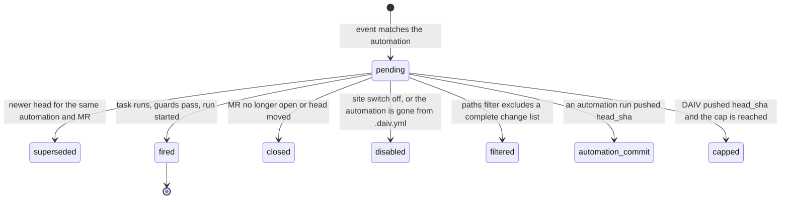

# Data Model: Merge Request Automations

Phase 1 of [plan.md](plan.md). Decisions behind each change are in [research.md](research.md).

## Run (`sessions.Run`, changed)

| Field | Change | Meaning |
|---|---|---|
| `acts_as_user` | **new**, `BooleanField(default=True)` | Whether the run acts as `user`: loads their personal MCP servers and USER sandbox environments and assigns merge requests to them. `False` for runs started by a CI identity token and for automation runs. `user` and `external_*` still decide spend, visibility and "Mine" (R6) |
| `trigger_type` | choices gain `automation` | See *SessionOrigin* |
| `merge_request_iid` | unchanged; now also set on API and MCP runs that target a merge request | Their session is the merge request's, or its owning session |

**Constraint `run_one_active_per_session`**: the condition gains `merge_request_iid__isnull=True` (R2):

```text
status IN (READY, RUNNING)
AND trigger_type IN (api_job, mcp_job, delegated_job, delegation_resume)
AND merge_request_iid IS NULL
```

`test_active_constraint_literals_match_enums` keeps checking the literals. A new assertion pins the null condition.

**Acting user**: `Run.acting_user_id` is a property: `user_id if acts_as_user else None`. Every reader that used `user_id` as the acting user switches to it: `queue.aenqueue_run`, `services.aget_task_run`, `inbox/drain.py` and `admission.py`.

## SessionOrigin (`sessions.SessionOrigin`, changed)

| Value | Label | Membership |
|---|---|---|
| `automation` | Automation | Not in `PERSON_STARTED`, `webhooks()`, the inbox trigger literals or `run_one_active_per_session`. In `ORIGIN_SEGMENT_CSS` and `_started_from` |

Stored on `Session.origin`, `Run.trigger_type` and `SpendRecord.trigger_type`. The migration alters all three fields' choices and drops and re-adds `run_trigger_type_valid` and `session_origin_valid`, as `0017_delegated_jobs.py` did.

## AutomationFiring (`sessions.AutomationFiring`, new)

One row per automation, merge request and head commit. It holds the pending state for the trailing combine, the one-firing-per-commit guarantee, the loop guard and the cap count (R9, R10).

| Field | Type | Meaning |
|---|---|---|
| `id` | UUID pk | |
| `repo_id` | `CharField(255)`, indexed | Repository slug |
| `merge_request_iid` | `PositiveIntegerField` | |
| `automation` | `CharField(64)` | The automation's `name` from `.daiv.yml` |
| `head_sha` | `CharField(64)` | The merge request's head when the event arrived |
| `event` | `CharField` choices: `opened`, `updated`, `ready` | The event that created or last updated the row |
| `actor_provider`, `actor_uid`, `actor_username` | `CharField` | The platform account whose action caused the event |
| `actor` | FK `User`, null | Its linked, active DAIV account when one exists, resolved at fire time |
| `daiv_commit` | `BooleanField` null | Whether DAIV pushed `head_sha`, set at fire time (`DaivCommits.ais_daiv`) |
| `status` | `CharField` choices | `pending`, `fired`, `superseded`, `automation_commit`, `capped`, `filtered`, `closed`, `disabled` |
| `due_at` | `DateTimeField` | When the settle delay ends (`now + AUTOMATION_SETTLE_DELAY`, 60 s) |
| `run` | FK `Run`, null, `SET_NULL` | The run it started, when `fired` |
| `cap_notice_posted` | `BooleanField(default=False)` | `True` on the one `capped` row that posted the cap comment |
| `created_at`, `updated_at` | timestamps | |

**Constraints and indexes**:
- **Unique** (`repo_id`, `merge_request_iid`, `automation`, `head_sha`): one firing per commit (FR-017).
- **Partial unique** (`repo_id`, `merge_request_iid`, `automation`) where `status = 'pending'`: at most one pending firing per automation and merge request, which is what makes the combine trailing-edge.
- **Index** (`repo_id`, `merge_request_iid`, `status`, `created_at`) for the cap count.

**State transitions**:



**Cap count** (R10): `fired` rows on the merge request with `daiv_commit = true` and `created_at` after the newest `fired` row with `daiv_commit = false`. When the count is at or above `site_settings.automations_max_daiv_push_runs`, the firing becomes `capped`. The first `capped` row after that newest person row posts the comment and sets `cap_notice_posted`.

**Lifetime**: rows are kept for reporting. No cleanup in this feature, since there is one row per push per automation.

## InboxEvent kind `MERGE_REQUEST_JOB` (`sessions.inbox.kinds`, new)

| Aspect | Value |
|---|---|
| Wakes | yes |
| Requester | the job's caller (`author` = DAIV user, or `author_provider`/`author_uid`/`author_username` for a CI actor) |
| Payload | `{prompt: str, agent_model?: str, acts_as_user: bool, source: "api_job" \| "mcp_job"}` |
| Subject | `merge_request(iid)` |
| Source key | `job({run_id})`, unique per session |
| Trigger type of the run it joins | `payload.source` |
| Reply | the final message as a new top-level comment on the merge request; after `MAX_EVENT_ATTEMPTS`, the "could not complete" note |

## Session (`sessions.Session`, unchanged schema)

**Automation sessions** use these values:
- `id`: `compute_automation_thread_id(repo_id, automation, iid)`, derived from `"{slug}:automation:{name}/{iid}"`;
- `origin`: `automation`;
- `merge_request_iid`: the merge request;
- `user`: none;
- title: `"{automation} on !{iid}"`.

**Merge-request-targeted jobs** on a merge request no DAIV session owns use the same session a mention would: `compute_thread_id(repo_id, MERGE_REQUEST, iid)`. When the job creates that session, its `user` is the caller, as the first commenter's is today.

## Repository configuration (`codebase.repo_config`, changed)

The `automations: list[Automation]` section is specified in [contracts/repository-config.md](contracts/repository-config.md).
- **Validation:** per entry. An invalid entry, or a later duplicate name, is dropped and logged at ERROR, and the rest applies.
- **Caching:** the section round-trips through the config cache.

## Site configuration (`core.SiteConfiguration`, changed)

| Field | Type | Default | Env var |
|---|---|---|---|
| `automations_enabled` | `BooleanField(null=True)` | `True` | `DAIV_AUTOMATIONS_ENABLED` |
| `automations_max_daiv_push_runs` | `PositiveIntegerField(null=True, validators=[MinValueValidator(1)])` | `3` | `DAIV_AUTOMATIONS_MAX_DAIV_PUSH_RUNS` |

Both are declared on `SiteSnapshot`. Their group is `FieldGroup(key="automations", match=("automations_*",), category="Runtime")`.

## Deployment settings (changed)

| Setting | Module | Default | Meaning |
|---|---|---|---|
| `DAIV_JOBS_CI_IDENTITY_AUDIENCE` | `core/conf.py` | `DAIV_EXTERNAL_URL` | The `aud` a CI identity token must carry |
| `CODEBASE_GITHUB_ACTIONS_OIDC_ISSUER` | `codebase/conf.py` | `https://token.actions.githubusercontent.com` | The GitHub Actions token issuer; GitHub Enterprise Server sets `https://HOST/_services/token` |

The GitLab issuer is `CODEBASE_GITLAB_URL`, else `https://gitlab.com`.

## CIIdentity (`accounts.api.ci_identity`, in memory)

The principal `request.auth` holds on a token-authenticated request. It has no table.

| Attribute | Source |
|---|---|
| `provider` | `gitlab` or `github`, the active `CODEBASE_CLIENT` |
| `repo_id`, `repo_platform_id` | the token's `project_path`/`project_id` (GitLab) or `repository`/`repository_id` (GitHub), checked against the repository |
| `actor_uid`, `actor_username` | `user_id`/`user_login` or `actor_id`/`actor` |
| `user` | `resolve_linked_user(provider, actor_uid)`, or `None` |
| `sha` | `sha` |
| `pk` | `"ci:{provider}:{actor_uid}"`, the throttle key |

## ChangedPaths (`codebase.clients`, value object)

`ChangedPaths(paths: list[str], complete: bool)` is returned by `RepoClient.get_merge_request_changed_paths`. A rename contributes both paths. `complete` is false when the platform truncated the list.
